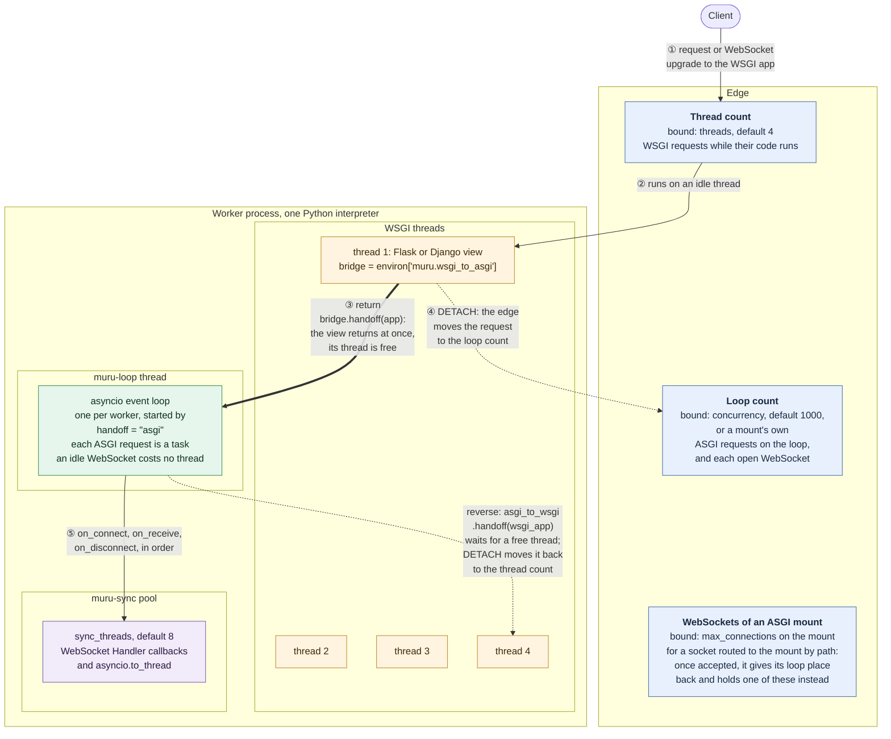

# Handing requests between WSGI and ASGI

[Mounts](mounts.md) choose between a WSGI and an ASGI application by
path. When the choice belongs in code, a request that has reached one
can be handed to the other in the same worker. A WSGI view takes a
WebSocket this way: it hands the upgrade to an ASGI application, which
accepts the socket on the worker's event loop, and the view's thread
goes back to the pool.

The diagram follows such a request through one worker, and through the
counts the edge keeps of what the worker is running:



1. The request reaches the WSGI application like any other, counted
   against the worker's `threads`.

2. It runs on one of the worker's application threads.

3. The view calls `bridge.handoff(app)`, which returns at once: the
   request goes on as a task on the worker's event loop, on its
   `muru-loop` thread, and the view's thread is free for the next
   request.

4. The worker tells the edge, which counts the request against the
   event loop's `concurrency` from then on.

5. With the [WebSocket adapter](#websockets-as-callbacks), the socket's
   calls run in order on the event loop's pool for synchronous code,
   sized by `sync_threads`.

A request goes the other way, from ASGI to WSGI, with
[`asgi_to_wsgi.handoff()`](#from-asgi-to-wsgi): it waits for a free
application thread, and the edge counts it against `threads` again.

## Enabling it

Handing requests off is enabled in the configuration, for the release's
own entrypoint or for a mount, by naming the interface the requests may
be handed to:

```toml
entrypoint = "chat.wsgi:application"
handoff = "asgi"

[mounts.admin]
path = "/admin"
entrypoint = "chat.admin:application"
handoff = "asgi"
```

A WSGI application hands requests to `"asgi"`. With the setting, the
worker runs an event loop for the applications its requests are handed
to, and WebSocket upgrades to that application's paths reach it as
WebSockets. Without it, an upgrade is an ordinary request.

An ASGI application hands requests to `"wsgi"`, and the setting gives
the worker application threads to run them on: the release's `threads`
for its own entrypoint, or, on a mount, `threads` as a number for a pool
of the mount's own, else the release's threads:

```toml
[mounts.api]
path = "/api"
entrypoint = "shop.api:app"
interface = "asgi"
handoff = "wsgi"
threads = 4
```

## From WSGI to ASGI

Every WSGI environ carries `muru.wsgi_to_asgi`. Its `handoff(app)`
continues the request as `app`, an ASGI application, and returns at once
with an empty response for the WSGI callable to return:

```python
async def chat(scope, receive, send):
    await receive()  # websocket.connect
    await send({"type": "websocket.accept"})
    user = scope["state"]["user"]
    ...


def application(environ, start_response):
    bridge = environ["muru.wsgi_to_asgi"]

    if not bridge.is_websocket:
        start_response("426 Upgrade Required", [("Content-Type", "text/plain")])
        return [b"websocket required\n"]

    bridge.scope["state"]["user"] = current_user(environ)
    return bridge.handoff(chat)
```

The object has:

| Attribute | Meaning |
| --- | --- |
| `scope` | The ASGI scope the application will receive, built from the request. Values put in `scope["state"]` before the handoff reach the application |
| `is_websocket` | Whether the request is a WebSocket upgrade |
| `handoff(app)` | Continue the request as `app` on the event loop. Raises `RuntimeError` once the response has started, which only a call to `write()` causes, or when the request has already been handed off |
| `handed_off` | Whether the request has been handed off, for middleware |

To decline a WebSocket, respond as usual: the client gets the status and
body as the answer to its upgrade.

An HTTP request can be handed off too, after the WSGI code has read some
of its body: the application receives the rest, as it arrives. The
request's context variables are copied to the application's task.

## WebSockets as callbacks

`muru.asgi.websocket.Handler` is an ASGI application that runs a
WebSocket's events as calls on an object, on threads, so a WSGI
application handles WebSockets in ordinary synchronous code:

```python
from muru.asgi import websocket


class Chat:
    def __init__(self):
        self.sockets = set()

    def on_connect(self, ws):
        self.sockets.add(ws)

    def on_receive(self, ws, message):
        for peer in list(self.sockets):
            try:
                peer.send(message)
            except websocket.ConnectionClosed:
                self.sockets.discard(peer)

    def on_disconnect(self, ws, code, reason):
        self.sockets.discard(ws)


chat = websocket.Handler(Chat(), subprotocol="chat")


def application(environ, start_response):
    bridge = environ["muru.wsgi_to_asgi"]

    if not bridge.is_websocket:
        start_response("426 Upgrade Required", [("Content-Type", "text/plain")])
        return [b"websocket required\n"]

    return bridge.handoff(chat)
```

`Handler(handler, subprotocol=None, headers=None, executor=None)`
accepts the socket, with `subprotocol` when the client offered it and
`headers` added to the response, then calls:

| Method | When |
| --- | --- |
| `on_connect(ws)` | Once the socket is accepted |
| `on_receive(ws, message)` | For each message: a `str` for text, `bytes` for binary |
| `on_disconnect(ws, code, reason)` | When the socket has closed, from either end |

Each is optional. The calls for one socket run one at a time and in
order, and the next message is not delivered until the current call
returns, so a call must not wait for another message on its own socket.
Different sockets run at once. Every call for a socket runs in the same
context, so a context variable set in `on_connect` is seen in the calls
after it, whichever thread runs them. An open socket that is waiting
for a message holds no thread.

The `ws` object passed to each call has:

| Attribute | Meaning |
| --- | --- |
| `send(data)` | Send a text message for a `str`, binary for `bytes`. Callable from any thread, so a call on one socket can send to others; it waits only while the client is slow to read. Raises `websocket.ConnectionClosed` once the socket has closed |
| `close(code=1000, reason="")` | Close the socket |
| `subprotocol` | The subprotocol it was accepted with, or `None` |
| `closed` | Whether it has closed |

An exception from a call is logged and closes the socket with 1011,
after which `on_disconnect` is called. When a worker stops, its open
sockets are closed with 1001.

The calls run on the event loop's pool for synchronous code, sized by
`sync_threads` (default 8), and take none of the `threads` that serve
WSGI requests. When every thread of the pool is busy, a call waits for
one. `muructl debug status` counts the threads running calls under
[SYNC](debugging.md#status), and `muructl debug stacks` names the socket's
request on each. The adapter runs under any ASGI server too, on a
thread pool of its own, or on `executor` when one is given.

## Applications with a lifespan

An application that requests are handed to, rather than served by a
mount, gets no lifespan startup or shutdown of its own. Register one
that needs them from a `post_fork` hook:

```python
# hooks.py, named by hooks = "hooks"
import muru.asgi

from chat.asgi import app


def post_fork(context):
    muru.asgi.register(app)
```

Each worker runs the application's startup once its event loop is
running, before it takes requests, and a failed startup fails the
worker. Its shutdown runs when the worker stops, after the requests in
flight. The state its startup fills is in the scope of every request
handed to it, beside what the WSGI code put in `scope["state"]`. A
worker without an event loop, one with no `handoff = "asgi"` and no
ASGI mount, does not start when an application is registered.

## Reaching the event loop

`muru.loop()` returns the worker's event loop, so WSGI code can run a
coroutine on it and wait for the result:

```python
import asyncio
import muru


def application(environ, start_response):
    result = asyncio.run_coroutine_threadsafe(fetch_quote(), muru.loop()).result(5)
    ...
```

`muru.request_id()` returns the id of the request being served, on
either side of a handoff.

## From ASGI to WSGI

On an HTTP request, the scope's Muru extensions carry `asgi_to_wsgi`.
Its `handoff(app)` continues the request as `app`, a WSGI callable, on an
application thread, and returns `None`, so the coroutine hands off and
returns in one statement:

```python
async def app(scope, receive, send):
    if scope["type"] == "http" and scope["path"].startswith("/legacy/"):
        return scope["extensions"]["muru"]["asgi_to_wsgi"].handoff(legacy_wsgi_app)
    ...
```

The callable gets an ordinary environ for the request, with the body the
coroutine has not received in `wsgi.input`, arriving as the client sends
it, and the scope's state as `environ["muru.state"]`. It runs in a copy
of the coroutine's context. `handoff()` raises `RuntimeError` once the
coroutine has sent anything, and after it the coroutine must not call
`receive()` or `send()` again, which raise. `handed_off` says whether
the request has been handed off.

When every thread is busy, a request handed over waits in the worker, in
turn, for one. If its deadline has passed by the time a thread takes it,
it is answered 503 with reason `queue_full`. How long requests wait is
measured: `muru_handoff_queue_wait_seconds` in the [metrics](metrics.md),
and the 95th percentile as `handoff wait p95` in `muructl scale status`,
whose [diagnosis](scaling.md#watching-and-overriding) names the wait
once it reaches 100 ms.

## How handoffs are counted

A request counts against the side that runs it, the worker's `threads`
or its event loop's `concurrency`, as [mounts are counted](mounts.md#how-requests-are-counted).
A request handed across moves to the side it was handed to: the
worker's threads, or the threads of the mount's own, for a handoff to
WSGI, and its event loop for a handoff to ASGI. Its place on the side it
came from is free for another request at once. When the side it moves
to is full, the request goes ahead anyway and takes the next place that
frees there. A WebSocket handed to ASGI holds its place among the event
loop's `concurrency` for as long as it is open. A mount's
`max_connections`, which counts open WebSockets apart from requests,
applies only to a socket routed to an ASGI mount by its path. The
access log marks a request handed across with
`handoff=asgi` or `handoff=wsgi`, and `muru_handoffs_total` counts them
in the [metrics](metrics.md). A [mount](mounts.md) is the better tool
when the choice can be made by path.

## Inside a framework

After a handoff, Muru ignores the status, headers and body the WSGI side
goes on to produce, and closes its response iterable without reading
it. A framework view can therefore hand off and return any response. The
object `handoff()` returns is also a WSGI application, so a Flask view
returns it directly:

```python
@app.route("/chat")
def chat_view():
    bridge = request.environ["muru.wsgi_to_asgi"]
    return bridge.handoff(chat)
```

A Django view hands off and returns an empty response:

```python
def chat_view(request):
    request.environ["muru.wsgi_to_asgi"].handoff(chat)
    return HttpResponse()
```

## When it is not enabled

Without `handoff = "asgi"`, the environ key is still there and
`handoff()` raises `muru.HandoffNotEnabled`, a `RuntimeError`, whose
message names the setting to add:

```
muru.HandoffNotEnabled: mount admin does not enable handing requests to ASGI;
set handoff = "asgi" on the mount
```

An ASGI application without `handoff = "wsgi"` likewise gets
`asgi_to_wsgi` in its scope, whose `handoff()` raises with the setting
to add.

A worker does not start when a handoff names the interface its
application already speaks, such as `handoff = "asgi"` on an ASGI
application, or when a gRPC mount has one.

Outside Muru, under another server, the key is absent, so code that
also runs elsewhere checks for it with `environ.get("muru.wsgi_to_asgi")`.
