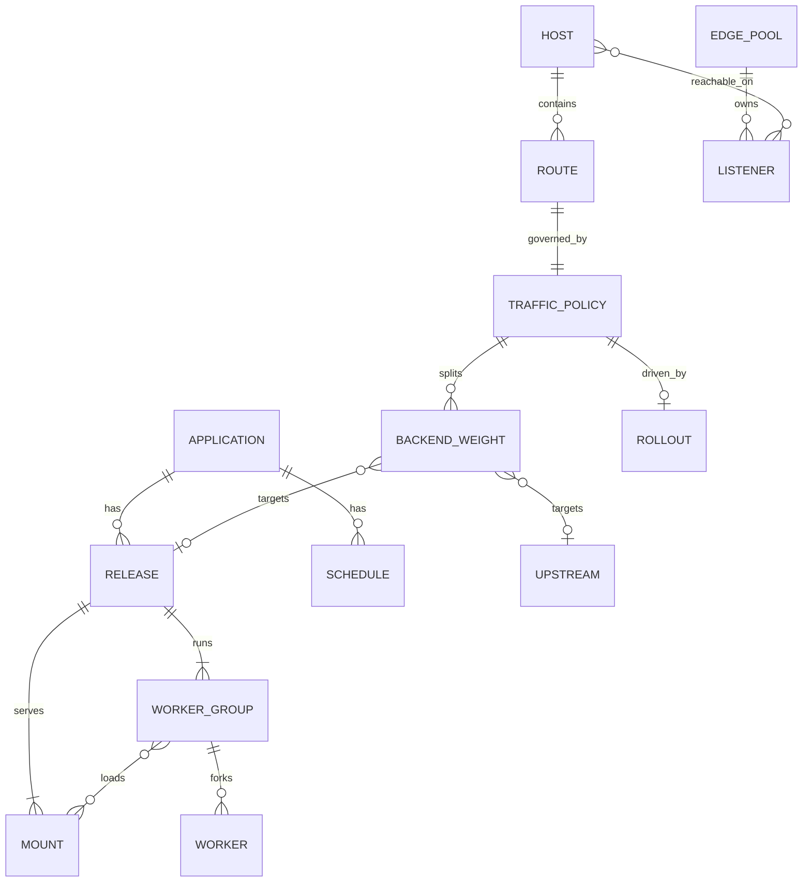

# 3. Data model

```{admonition} Design specification
:class: note

This page is part of the Muru design specification and describes intended
design, for contributors. The user documentation is authoritative for released
behaviour. See the [specification index](index.md) for status and how the
specification is maintained.
```

Everything the daemon manages is a named object in desired state. Releases are immutable, and traffic policy is the only thing that decides whether a release serves requests. Separating the two is what makes deploys, canaries and rollbacks simple policy changes.



## 3.1 Objects

| Object | Name form | Key fields | Mutable |
| --- | --- | --- | --- |
| Application | apps/shop | default interface and entrypoint, defaults for releases, reload policy, schedules, memory and timeout defaults | Yes |
| Release | apps/shop/releases/r42 | source (directory, or image digest), interpreter request and resolved interpreter, environment, mounts, worker groups, source fingerprint | No, except scale and limits applied live |
| Mount | part of a release | path, interface (wsgi, asgi or grpc), entrypoint, internal flag, thread pool, concurrency and connection limits | Paths and limits live, entrypoints fixed |
| Worker group | part of a release | paths or mounts, processes, threads, scaling, timeouts, memory policy | Sizes live, thread changes are rolling restarts |
| Worker | .../groups/default/workers/w3 | pid, state, slots, metrics | Observed only |
| Host (virtual) | hosts/shop | names and patterns, listeners, TLS, canonical name, host-level settings | Yes |
| Route | routes/shop-root | host, path and predicates, target, limits, buffering, error pages, upload and redirect settings | Yes |
| Traffic policy | routes/shop-root/traffic | backend weights, stickiness, hash key and salt, overrides, mirroring | Yes |
| Upstream | upstreams/legacy | addresses, protocol, TLS, health checks, header trust | Yes |
| Rollout | apps/shop/rollouts/... | strategy, steps, gates, state | Yes, while running |
| Schedule | apps/shop/schedules/... | cron or dated window, time zone, floor and ceiling, warm-up, freeze | Yes |
| Edge pool | edge/pools/public | listeners, processes, threads | Yes |
| Event sink | events/sinks/... | kind, endpoint, filters | Yes |
| Overlay | overlays/nightly-backup | partial configuration, trigger, preconditions, warm-up, latch, advisory, priority | Yes |
| Client class | client-classes/ai-crawler | ordered match rules, lists, verification | Yes |
| Rate limit | rate-limits/crawlers | match, key, rate, burst, action | Yes |
| Variant | part of a release | interpreter, environment build, environment variables, worker groups | No, as part of the release |

## 3.2 Identity and naming

- Names are lowercase letters, digits and hyphens, up to 63 characters per segment.
- Release ids are chosen by the user or generated (r1, r2, ... per application). A release is addressed as app@release in the CLI.
- Every object has a resource_version for optimistic concurrency and an audit trail of who changed it.

## 3.3 Inheritance and precedence

Settings resolve from the most general to the most specific, and each layer only states what differs:

1. Built-in defaults.
2. Daemon configuration (global settings).
3. The application's own [tool.muru] table, read from the release source (section 6.8).
4. Application settings in the controller.
5. Release settings, then worker group and mount settings.
6. For request handling: route settings. A virtual host's settings are its site's defaults and sit beneath the application's, between layers 2 and 3, so a request's setting is the first set of the route, the mount or worker group, the release, the virtual host, the node and the default (ADR 0049).
7. Flags given at deploy time, and time-limited runtime overrides such as log levels or temporary scale floors.

muructl config show --effective prints the merged result with the layer each value came from.

- **Details fixed by the implementation.** A release records, when it is created, the layer each of its settings came from: `the release table` (a declared release's table) or `deploy flags`, `the application`, `[tool.muru]`, `the source's .venv` (the interpreter alone) or `default`; a release created before this records none. A deploy takes every setting a flag can set from the first layer that gives it: the flags, the application's settings for the keys it holds (below), the source's `[tool.muru]` table, then the default, and never the release before it (issue 861, ADR 0076). That covers the entrypoint and its factory settings, the interpreter, interface, preload mode, hooks, reflection, processes, threads, sync threads, concurrency, `max_requests`, `max_lifetime`, the host's timeouts, the memory policy, the redirect settings, the file hint keys and the gRPC-Web origins; environment variables and secrets layer by name, so one the application's settings give stays unless the source's table or a flag sets the same name. Tables come from the source's table: worker groups, mounts, static entries (with `--static` laid over them), logging, scaling, error pages and the instrumentation list (section 6.15), so a source that drops a group or a static entry drops it. The interpreter is the flag's, else the source's `.venv`, else its own request, else python3, and never an earlier release's, which may be in another source's `.venv`. A deploy taking nothing from the release before it means a flag given for one release applies to it alone, and a rollback leaves nothing for the next deploy to take; what is to last goes on the application or in `[tool.muru]`. The previous-release layer, `muructl deploy --fresh` and the deploy request's `fresh` were removed (issue 861). `muructl config show [APP] --effective` heads the exported configuration with a line for each setting of each serving release, `app@release: key = value (layer)`, covering the entrypoint, interpreter, interface, preload mode, processes, threads, sync threads, concurrency, `max_requests`, `max_lifetime`, the host's timeouts, the memory policy and the redirect settings, and says when a release has none recorded. The layers are not settings: a declared release whose settings match the recorded ones is unchanged whatever its layers. Layer 2 holds the Python logging defaults alone (`[logging.python]` in the daemon's file, section 11.4), which are read when a host starts rather than recorded with the release, so `config show --effective` names them `daemon configuration` as they are now and a reload reaches each application at its next restart or deploy; worker group and mount settings are not attributed.
- **Application settings (issue 899, ADR 0076).** Layer 4 holds release settings: environment variables and secrets by reference, processes, threads, sync threads, concurrency, `max_requests`, `max_lifetime`, the host's timeouts and the memory policy, which every release deployed after they are set takes, under the release's own flags or table and over the source's `[tool.muru]`; variables and secrets layer by name. The entrypoint, interface, interpreter and the other settings that say what the code is or name a path in one source are not among them, nor are tables or the limits on requests the edge serves. They are kept on the application in the state store (a `settings` column of `apps`), set by `muructl app set APP` with the deploy's flags (`--replace` drops the rest first), removed by `muructl app unset APP KEY...` by the key a release records its layer under (`processes`, `timeouts.hard_timeout`, `memory.soft_limit`, `env.NAME`, `env`) or `--all`, and listed by `muructl app show APP`, through the admin call SetAppSettings and the `settings` of GetApp; setting them creates the application. A document's `[app.NAME]` takes the same keys (`env`, `processes`, `threads`, `sync_threads`, `concurrency`, `max_requests`, `max_lifetime`, `timeouts` with the eight host timeouts, `memory`), states them in full as it states the identity, and `config export` writes them; a declared release takes its document's settings for the application. Changing them changes no release: a release records its settings, each from the layer `the application` when the application gave it, as it is created. A managed HTTP release takes only the environment from them. The MCP tools `app_settings`, `set_app_settings` and `unset_app_settings` run the same commands.
