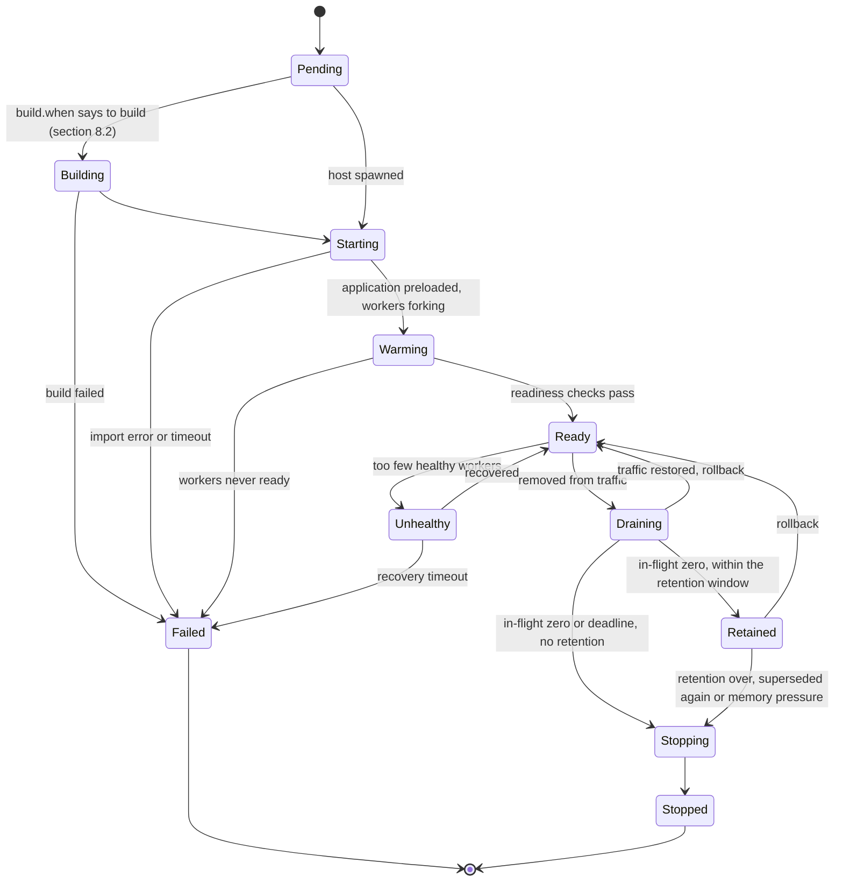
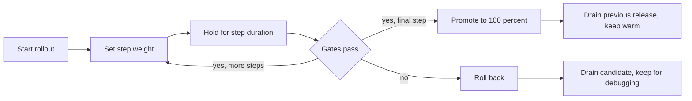
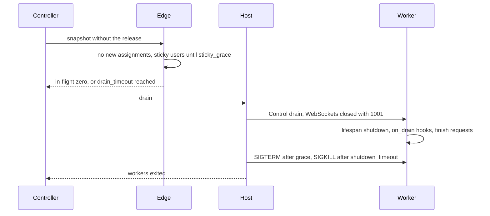
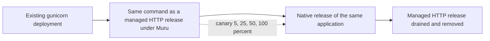
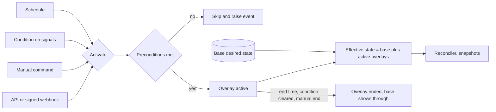

# 9. Releases and traffic management

```{admonition} Design specification
:class: note

This page is part of the Muru design specification and describes intended
design, for contributors. The user documentation is authoritative for released
behaviour. See the [specification index](index.md) for status and how the
specification is maintained.
```

A release's lifecycle state says whether it can serve. Its traffic policy says whether it does. Every deployment strategy is a sequence of policy changes plus lifecycle management, and none of them restarts a shared server.

## 9.1 Release lifecycle



A host that exits or times out before its workers are ready fails the release, and the failure carries the reason from what the host wrote to the release's log: its own line saying it could not load the application, a worker's saying it failed to start, or a traceback's last line. The deploy's error, its JSON, the `release.failed` event and the release's note all give it, so it takes no second command to see why.

Superseded releases stay warm for a retention window (default 30 minutes, or the deploy's retain setting), so rollback avoids a cold start; one release per application is retained, and a release superseded again is stopped. A rolled back or aborted rollout's candidate is kept outside that slot (section 9.3), so the release a rollback goes to stays warm beside it. Once drained, a retained release scales down to a warm floor: its preloaded host plus retain_workers per required worker group (default 1, and 0 for a group whose min_workers is 0, which is configured to hold no workers; an explicit retain_workers applies to every group). Its note is written from what it keeps: warm, a rollback to it instant, while every group keeps a worker; its host alone, a rollback forking a worker; or idle, its host stopped by host_idle_timeout (section 7.4), a rollback waiting for its import. A retained release is neither scaled nor idled, so the note holds until it changes, as when memory pressure drops it to its host and the note says so. Because workers fork from the preloaded host, scaling back up takes seconds at most. If the node goes over its memory budget, retained releases drop to the host alone, and are stopped, oldest first, if that is still not enough. These defaults are provisional and flagged for review (section 19.2). Readiness requires every required worker group, in every variant, to have its minimum ready workers and the release checks of section 9.11 to pass.

- **Details fixed by the implementation.** The warm floor's retain_workers is `muructl deploy --retain-workers` (DeployRequest's `retain_workers`), 1 by default and for releases deployed by apply, a rollout or a promotion; 0 keeps the host alone. The workers beyond it in each group are drained as the release is retained, and a rollback to it takes traffic at once and asks each group for its count again. Under memory pressure the drop to the host alone and the stop come from the node's budget (section 7.4).
- **Starts beside the loop (issue 693).** A release's start runs on a task beside the daemon's loop, so the loop keeps taking commands and doing its once-a-second work while a release builds, preloads, runs its `before_fork` gates and waits for its workers. The loop prepares the start (the release, its user, secrets and environment, the budget check and the host's settings), the task builds the environment, provides the runtime library, starts the host or a managed server's instances and waits for them, and the loop takes the host into what runs when the task reports and carries on with what the start was for: a deploy's switch and drain, a promotion, a held deploy, a rollout's first step, a rollback, a wake, a restart of a failed serving release or the restore at the daemon's start. A promotion's `before_promote` gates run on a task the same way, its switch following once they pass, and a rollout being promoted takes no other step meanwhile. The starts of one application run one at a time, in the order asked for, and those of different applications side by side; a release starting counts against the node's memory budget, with the memory its groups are expected to hold, from the moment its start begins. A start asked for of a release already starting joins it and is given its outcome. A drain or removal of a release that is starting, the application's removal included, cancels its start: the task stops the host if it has started, the gate under way with it, and the release is `stopping` until then and `stopped` once it has, with a message saying the start was cancelled and why. A scale of it, its scale status and a request to its workers (section 11.7) are refused, saying it is starting and to try again once it is ready. A daemon that stops, whether it drains, detaches or upgrades, cancels every start under way and waits up to 60 seconds for each to stop what it started, since a host still starting has no record yet for the next daemon to adopt.
- **Details fixed by the implementation.** A release whose workers are all ready stays warming until the daemon has pushed the snapshot that gives it to the edge, as the serving release, a held release, a canary candidate or a release a traffic policy names, and is ready only then, so `muructl release wait` never answers before a request can reach it. The `release.ready` event marks the workers' readiness, with the time they took, and comes before `traffic.switched`.

**Removing releases.** Muru never removes a release on its own; `muructl release prune [APP] --keep N` and `muructl release remove` do when asked, through the daemon, which knows what is in use and can write the files of a release run as another user. Each asks first, with what would go and the disk space that would free, needs --yes without a terminal and has --dry-run; each removal records a release.removed event. Prune and remove never take the application's serving release, its rollback release, any release still running or on its way to it, a retained one among them, or one that a route's traffic split or a rollout under way uses. The daemon checks again as it drops the record, in one step of its command loop, so a promotion or rollback between the plan and the removal cannot lose the release, and a removal waits for an apply under way.

--keep N keeps the N newest releases that have not failed, beside the protected ones, and --keep is required, so a mistyped command removes nothing. Failed releases do not count towards N. A failed release may still be needed for its logs, so prune keeps one until both the serving and the rollback release were created after it; the older of the two is the cutoff, because a rollback swaps them and the rollback release can then be the newer, and an application with only one of them, or neither, keeps its failed releases. Past the cutoff a failed release goes whatever N is. A release that applied files declare stays unless --force, since the next apply would create it again: an apply records what its files declare for each application they name, in the store, replacing what the last apply declared.

`muructl release remove APP@ID` removes one release, by name, and refuses the protected ones with why. Naming a failed release removes it without waiting for the cutoff, and a release applied files declare goes, since the operator named it.

`muructl app remove APP` removes a whole application: whatever runs is drained, and every release goes with its environment, bytecode and logs. It is refused while a route, including one an active overlay lays over the routes, still sends traffic to the application, while a rollout of it is under way, and while a release of it is pending or being built other than by a start, which the removal cancels. The checks, the drains and dropping the records are one step of the command loop.

What goes with a release: its record, its environment, its bytecode, its run directory and, unless --keep-logs, its log and log archives. A release's source directory is never touched, since Muru points at it and does not own it. The directories under STATE/envs and STATE/pycache and the log and run directories named for the application go when they are empty. The same removal serves `muructl apply --prune`, so it takes logs too, and an apply undone after a release did not start, which leaves the release's log so that it can say why. `muructl release list` shows what each release takes, counted from the same files: the bytes allocated with each hard-linked file counted once, and, separately, what removing it gives back, which is less when uv's cache holds further links to the environment's files. Measuring walks the environment, so the release list asks for it and other callers of ListReleases do not pay for it.

## 9.2 Strategies

| Strategy | Mechanism |
| --- | --- |
| Blue/green | Start the new release, smoke test through a preview header or hostname, flip weights 0/100, drain the old release and keep it warm |
| Weighted canary | Stepped weights with holds and gates, automatic rollback on failed gates |
| A/B by cohort | Bucket ranges, header or cookie matches, with a salt per experiment |
| Preview or dark launch | Header, cookie or hostname pins a release without public traffic |
| Per-route policies | Different routes of one application on different releases |
| Shadow traffic (later) | Mirror safe requests to a candidate and discard its responses |

- **Details fixed by the implementation.** An A/B cohort by header or cookie is a client class (section 4.14) whose rule matches them, given a release by a route's `traffic.classes`, which comes before a sticky cookie and the split; a cohort by bucket range is a `split` with a `salt` of its own for the experiment. Per-route policies are each route's own `traffic` table: a split giving one release 100 keeps a route on it while the application's other routes follow the serving release. A blue/green promotion by hand, by `muructl rollout bluegreen`, the dashboard, the API or an apply, is refused while a rollout of the application is under way, naming `muructl rollout promote` and `muructl rollout abort`, which end it explicitly; it would otherwise move the traffic the rollout is moving, past its gates. The rollout's own promotion of its candidate is not refused.

## 9.3 Canary gates



Gates compare the candidate with the baseline over the same window, with a minimum request count before a verdict: 5xx rate, p95 and p99 latency, worker crashes and timeout kills, queue wait, and optional probe URLs. Steps can require manual approval. Every step and gate result is an event.

- **Details fixed by the implementation.** A candidate that a failing gate or `rollout abort` takes out of traffic is retained for inspection only: for 10 minutes rather than the retention window, with the warm floor of section 9.1, and outside the application's one retained slot, so the retained release a rollback goes to is not stopped. Its note says it is kept for inspection and is not a rollback target, since a rollback goes to the previous serving release. Under budget pressure it makes way before any rollback target, and a later deploy stops it as it stops any older retained release. The gates are `max_error_rate` (1%), `max_p95_ms` and `max_p99_ms` (none), read from the edge's request counters and total request time histogram for each release, and `max_worker_faults` (0): the release's `worker.exited` events at warning or error level, a crash, and its `worker.timeout_killed` events, the hard timeout's and the loop stall timeout's, counted by the daemon from the host's events; the host raises a timeout kill when it decides to replace the worker, not when the old worker exits after its drain grace. Each fails only when the candidate is over its limit and worse than the baseline over the step; the fault gate is judged at once, before `min_requests` (100) is reached, since one crash is evidence enough. `max_queue_wait_p95_ms` (none) reads the queue phase of the same histogram. `probes` are http or https URLs the daemon requests every 5 seconds through the edge, from the candidate and then the baseline, each with the `Muru-Preview` header naming the release; a 2xx or 3xx answer within 5 seconds passes, a round's failures are recorded together once both releases have answered, and, judged at once like faults, the gate fails when the candidate has more failed probes over the step than the baseline. Probe requests are counted as the release's requests. With no host declared, the snapshot carries the policy of the one application serving (section 4.3), the rollout's share alone, and the edge chooses among its releases with it as a route's policy does, previews included; without a rollout that application's requests go to its serving release as before.

## 9.4 Bucketing and stickiness

- bucket = hash(salt, key) mod 10000. Release ranges are contiguous, and the newest release grows downward from the top, so a user in the canary at 10% stays in it at 25%.
- Hash keys: an anonymous id cookie issued by the edge (default), a named header such as a user id set by a trusted upstream proxy, an application cookie, or the client address as a last resort.
- Strict stickiness issues a cookie recording the release, honoured while that release serves and ignored once it stops. sticky_grace bounds how long sticky users keep a draining release alive.

## 9.5 Draining



- **Stops beside the loop (issue 699).** The daemon takes a release out of what it routes to and runs in one step of its loop, and the stop of its host or a managed server's instances, with their grace periods and the release log relay's last lines, runs on a task beside the loop, so the loop keeps taking commands and doing its once-a-second work while a release stops. The release is `stopping` until the task reports, and `stopped` then, its run directory and scale pins forgotten and `release.stopped` raised; one whose processes outlast the stop's wait (the drain timeout, or the release's stop budget when that is longer) is recorded stopped all the same, the event saying so. What waits on the stop carries on when it has ended: `muructl drain` is answered, an application's removal drops its records, and a start of the release, such as a rollback to it, begins. A removal of a release that is stopping is refused until it has stopped. A release that stops no longer counts against the node's budget, so a stop that makes room for another release makes it at once. A daemon that stops waits for the stops under way, each for as long as its own wait, since the next daemon has no record to adopt the release by.

## 9.6 Rollback and deploy freezes

Rollback first scales the retained release back to its previous worker counts (forks from its preloaded host), then restores the previous traffic policy once those workers are ready, so the rollback does not land on a single warm worker. A release outside its retention window is started again first. Schedules with freeze_deploys block new releases and rollouts during their windows unless an explicit override is given, which is audit-logged.

- **Details fixed by the implementation.** A freeze is `freeze_deploys = true` on an application in any active overlay, a schedule's included. It refuses DeployRequest, an apply that would deploy one of the application's releases, StartRollout, PromoteRelease and a rollout's promotion, each of which takes `override_freeze` (`--override-freeze`), recorded as a deploy.freeze_overridden warning event naming the overlays; a rollout under way holds its step while the freeze lasts, and rollback, pause and abort are never frozen.

## 9.7 Shared state during overlap

Muru cannot make two releases safe to run against shared state. The documentation must recommend expand and contract database migrations and compatible cache formats for the overlap window, and muructl exec is the supported way to run migrations as a deliberate step. A declared command can also be a gate (section 9.12): `before_fork` runs the expand step as the release starts, before its workers fork, and `before_promote` the contract step just before a promotion moves all traffic to the release.

## 9.8 Reload

Reloading is off by default. Every reload creates a new release from the same source and drains the old one; there is never an in-place module reload.

| Mode | Trigger | Use |
| --- | --- | --- |
| off | muructl reload APP, or a deploy | production |
| touch | modification time of the entrypoint module or a trigger file | hosts updated in place |
| watch | changes under watched directories | development |

- One watcher in the daemon or muructl run process (inotify or FSEvents), never per worker. `__pycache__`, `.git`, virtualenvs, `*.pyc`, `node_modules` and editor files are ignored, and `.gitignore` is honoured.
- Under muructl run, `**/*.py` is watched by default; --reload-include adds patterns to it and --reload-exclude takes files out, an exclude winning over an include, so a run that watches templates alone excludes `**/*.py` rather than losing it by naming a pattern. The project's pyproject.toml, uv.lock and .python-version are watched whatever the patterns say, since a change to them is a new release and, under build.when, a build before it (section 8.2). The start-up line names the directories and patterns in force.
- Changes are debounced (default 300 ms). A release still starting when new changes arrive is abandoned and replaced. A failed import leaves the previous release serving and shows the error, naming the release that failed: the attempt keeps its number, as a failed deploy does under the daemon, so under muructl run the fix after a failed r3 is r4.
- Polling is used when poll = true or when the inotify watch limit is reached, which is needed on some network file systems and macOS container bind mounts.
- Releases from mutable paths record a source fingerprint (git revision and dirty flag, or a hash of watched files).

## 9.9 Managed HTTP server releases (migration)

To let existing deployments move to Muru in steps, a release can run an ordinary HTTP server process (gunicorn, uvicorn, Granian, mod_wsgi-express, or any server that can bind a given address) instead of Muru workers. Muru starts and supervises it and routes to it like an upstream, so it gets releases, traffic policies, drains and rollbacks. The intended use is a cutover: run the current deployment unchanged under Muru first, then canary traffic to native workers.



```toml
[app.legacy.release.r9]
kind = 'http'
profile = 'gunicorn'           # gunicorn, uvicorn, granian, mod_wsgi-express, uwsgi or generic
command = ['gunicorn', '--workers', '4', '--bind', '{bind}', 'legacy.wsgi:application']
cwd = '/srv/legacy'
env = { DJANGO_SETTINGS_MODULE = 'legacy.settings' }
bind = 'unix'                  # unix or port
instances = 1
readiness = { path = '/healthz', timeout = '60s' }
```

- **Binding:** the daemon allocates a Unix socket path or a free loopback port per instance and substitutes it for {bind} in the command, also setting MURU_HTTP_BIND (and PORT). Profiles know each server's flag for Unix sockets.
- **Readiness:** an HTTP probe on the configured path, retried until timeout. Without a path, readiness means the socket accepts connections and answers any HTTP response.
- **Lifecycle:** each instance is a supervised child (or container) with crash restarts and backoff. Drain stops new requests at the edge, waits for in-flight requests, then sends the profile's graceful stop signal, then SIGKILL after the grace period.
- **Profiles** hold per-server defaults: graceful stop signal (SIGTERM for gunicorn, uvicorn and Granian, SIGINT or SIGTERM per mod_wsgi-express mode), how to bind a Unix socket, and readiness hints. uwsgi binds with `--http-socket` and adds `--master` and a master-start hook that turns SIGTERM, a reload in uWSGI 2.0, into a graceful stop. generic needs these set explicitly.
- **Traffic:** a managed HTTP release is a normal backend in traffic policies, so canaries, A/B splits, sticky sessions, previews and rollback work between it and native releases of the same application.
- **Logs and events:** each instance is started by a log relay of its own, its parent (section 11.3, ADR 0059 and ADR 0060), which outlives a daemon that detaches or upgrades as the instance does. Its lines go to the release's log file with the time each was read and a tag naming the instance and the stream (`muru.instance[0]:`, `muru.instance[0].stdout:`), and the relay reopens the file on rotation, so nothing is lost. Lifecycle changes are events.
- **Scope limits:** fixed instance counts only (no autoscaling of instances), and none of the Python-specific features (preload by Muru, worker groups, mounts, soft timeouts, memory policy, Python signals, descriptor passing). Requests are re-serialised as HTTP with the normalisation rules of section 4.13. The server's own process management stays in charge inside each instance.

Instance autoscaling and additional profiles remain future ideas (section 20.1).

- **Details fixed by the implementation.** A managed release is declared with `kind = 'http'`, `profile`, `command`, `cwd` (or `source`, which it stands in for), `bind` (unix, the default, or port), `instances` (1), `readiness` with `path` and `timeout` (60 s), and `stop_signal`, or deployed with `muructl deploy --server PROFILE` and the command after `--`; the worker settings of a release do not apply to it and are refused, while `env`, `error_pages`, `error_override`, `maintenance` and `timeouts.shutdown_timeout` do apply. `{bind}` in the command is replaced by the address in the server's own form (`unix:PATH` or `127.0.0.1:PORT` for gunicorn and generic, the socket path or `127.0.0.1:PORT` for uvicorn and Granian), `{socket}` by the socket path and `{port}` by the port; a command naming none of them gets the profile's flags appended (`--bind` for gunicorn, `--uds` or `--host --port` for uvicorn and Granian, `--host --port` for mod_wsgi-express, nothing for generic), and mod_wsgi-express binds a port only. The environment carries MURU_HTTP_BIND, PORT for a port and MURU_INSTANCE. The ports of a release are found together, each by binding port 0 on loopback, with every listener held open until the last port is known, so that no two instances are given the same one; the listeners are closed before the instances start, so a port can still be taken by another process before its instance binds it, which fails the release. Sockets live under the release's run directory, open to the edge's group (section 10.9), and the instances run as the application's user. Readiness is a GET of the path every 100 ms, each within 2 s, passing on 2xx or 3xx, or any HTTP response without a path; an instance that cannot be started, one that exits first, or the timeout, fails the release, and a release that fails leaves nothing running: the instances already started are stopped, with `shutdown_timeout` to stop in, whether the failure was a later instance's start or the wait for readiness. The stop signal is TERM for every profile, mod_wsgi-express included, unless `stop_signal` names another, and it goes to the instance's own process alone, since a server's stop signal is meant for its master. The daemon signals an instance through its relay and never directly while the relay runs (ADR 0060): SIGTERM to the relay makes it send the instance the stop signal, and SIGUSR2 makes it kill the instance's group; the relay is the instance's parent, so neither can reach a process that has since been given the instance's pid. A relay that does not exit within 500 ms of SIGUSR2 is killed, and what is left of its instance with it, checked by pid and start time. Each instance is started in a session of its own, so its pid is the id of a process group holding whatever it started, and after `shutdown_timeout` (5 s) SIGKILL goes to that whole group, not to the one process, so a master that is killed takes its workers with it. Once the instance's process is gone, by its own exit or the kill, the group is looked for (signal 0 to the group): anything still in it is sent the stop signal and, at the end of `shutdown_timeout` or 500 ms later when less than that is left, SIGKILL. A process that left the group for a session of its own is not found. The instances of a release are stopped side by side, against the one deadline. An instance that exits is started again after a wait doubling from 1 s to 30 s, reset once it has run for a minute, recorded as server.exited, server.started and server.failed; the release stays ready. An instance is not started beside what the one before it left running: when an exit is seen, whatever is still in the instance's process group is sent the stop signal, and the server.exited event says processes were left behind; the group is looked for on every check, and forgotten once it is empty, since its id may be given out again from then on; anything still in it when the wait ends is sent SIGKILL, once, and the start is put off to the next check. A stop that comes during the wait clears the group as it does a stopping instance's, and a daemon that detaches or upgrades during the wait kills what is left in the group as it goes, since the record has no place for it and the next daemon would start the instance beside it. The edge routes to the release as an upstream named `app@release`: http1, X-Muru headers trusted, ejection after 3 failed requests for 5 s, no probes; requests are labelled with the application, the release, `http` as the group and the instance's address as the mount, muru_upstream_health reports each instance under that name, and muru_workers_ready counts the instances running under group `http`. Standard output and error go through the instance's relay, `muructl relay run` in the mode in which it is the parent (section 11.3): one relay an instance, each with its control socket `relay-N.sock` and its record `relay-N.toml` in the release's run directory, all of a release's relays appending to the one release log and each reopening it on SIGUSR1. The relay writes its record when the instance starts, with the relay's and the instance's pids and start times, and again with the instance's wait status as soon as it has reaped it, and `servers.toml` carries the relay's pid and start time beside the instance's. An instance whose relay exits has ended: its status is the one the relay recorded, and a relay that recorded none was lost, so whatever is left of the instance, found by its pid and start time, is killed and the exit reported as the relay lost (ADR 0059: a relay that dies takes its instance's output with it). A daemon that detaches or upgrades leaves the instances and their relays running and the next daemon re-adopts them from `servers.toml` in the run directory, instance by instance: one whose relay is still there is taken over with it; one whose relay is gone ended while no daemon ran and is reported by the first check with the status its relay recorded, waiting as any exit does before it is started again; and one that was waiting to be started when the record was written (pid 0 in the record) is due at once and so started by the first check. The record carries each instance's exits in a row, and an instance that is taken over counts as running since its recorded start, so the waits, and the recovery after a run of a minute, carry on across daemons. The release stays ready and its release.adopted event names the pids taken over and the instances started again. A process is the recorded one when something has its pid and the start time the kernel gives that process is the one recorded beside the pid (`start_time` in `servers.toml`): on Linux `starttime`, field 22 of `/proc/PID/stat`, in clock ticks since boot, read from after the last `)` so that a command name with spaces or parentheses does not shift it; on macOS `pbi_start_tvsec` and `pbi_start_tvusec` from `proc_pidinfo` with `PROC_PIDTBSDINFO`, as microseconds. It is compared for equality and means nothing else. A pid whose process has another start time, or none that can be read, has passed to another process: the instance is gone, and that process is never signalled. The check is made at adoption and again each time an adopted process is looked at or signalled, since it is not the daemon's child and its pid can be given out again once it exits. An instance recorded without a start time (0: by a daemon from before it was kept, or because it could not be read) has only its pid to go by, so it is adopted only if its address also answers an HTTP request within 2 s, and is otherwise started again with the process that has the pid left alone. An instance whose start time matches is adopted whether or not it answers: replacing a running instance that does not answer is a question of liveness, which adoption does not decide. Adoption is refused, and the release marked stopped and, if it serves, started afresh, only when the record cannot be read or names no instance. `muructl release list` shows the instance count and the profile, `muructl release show` each instance's index, pid (0 while it waits to start again), address and start time, published by the daemon on its one-second check and when the instances start or are adopted, the start time kept in `servers.toml`, and `muructl scale` refuses a managed release. The instances' processes are run by a supervisor in the controller that knows nothing of HTTP: it starts them, starts again one that exits with the waits above, records them for the next daemon, takes them over from that record and stops them, and it is written to be shared with other programs the daemon will supervise. What is HTTP's stays with the managed server: the addresses, which it keeps beside the supervisor's record in `servers.toml`, the profiles and the readiness probes. A deploy of native workers after a managed release takes nothing from it, its workers, entrypoint and interpreter coming from the request, the source's table or the defaults, as for an application's first release.

## 9.10 Overlays

An overlay is a named, partial configuration that is layered on top of the base desired state while it is active. Overlays never modify the base configuration, so ending one simply stops applying it, and changes made to the base in the meantime show through. One mechanism covers timed blue/green switches, maintenance windows, read-only periods for backups, reduced-feature modes during expected peaks, circuit breakers and crawler handling.



**What an overlay can set**

- Traffic policy weights and pins for routes (for example a timed switch to a new release).
- Maintenance mode for applications or routes, with its exemptions.
- Site modes and method restrictions (section 4.15), for read-only or limited operation.
- Route targets, for example sending a route to a static snapshot, a different release or an upstream.
- Client class routing and rate limits.
- Scaling floors, ceilings and caps, and deploy freezes. Capacity schedules (section 7.5) are shorthand for overlays that set only these.
- Error page selections.

```toml
[overlay.nightly-backup]
routes.shop-root = { mode = 'read-only', deny = ['POST', 'PUT', 'PATCH', 'DELETE'] }
trigger = { schedule = { cron = '0 2 * * *', duration = '1h', timezone = 'Australia/Sydney' } }

[overlay.cutover-r43]
routes.shop-root.traffic = { pin = 'r43' }
trigger = { schedule = { start = '2026-11-02T09:00', timezone = 'Australia/Sydney' } }   # no end, so it stays until promoted or ended
warm_up = { start_release = 'r43', lead = '30m' }
preconditions = { release_ready = 'r43', probe = '/healthz' }

[condition.shop-errors]
when = "error_rate{app='shop',reason='app_error'} > 0.2"
for = '1m'
clear_when = "error_rate{app='shop',reason='app_error'} < 0.02"
clear_for = '5m'

[condition.crawler-surge]
when = "request_share{app='shop',client_class='ai-crawler'} > 0.3"
for = '5m'
clear_when = "request_share{app='shop',client_class='ai-crawler'} < 0.1"
clear_for = '15m'

[overlay.db-outage]
routes.shop-root = { target = { static = '/srv/shop/snapshot' }, mode = 'degraded' }
trigger = { condition = 'shop-errors' }
latch = true

[overlay.crawler-limits]
routes.shop-root.client_routes = { ai-crawler = { rate_limits = ['crawlers'] } }
trigger = { condition = 'crawler-surge' }
```

**Triggers**

| Trigger | Behaviour |
| --- | --- |
| schedule | One-off start and optional end, or cron plus duration, in a named time zone with daylight saving handled. An overlay with a start and no end stays active until ended or promoted. A declared command's schedule (section 9.12) reads its cron expression the same way |
| condition | A named condition (below): an expression over Muru's signals (request rate and share, error rate by reason, latency percentiles, queue wait, saturation, scaling at maximum or denied by budget, node memory, upstream health), with separate fire and clear expressions and waits, declared once and named by the overlay |
| manual | muructl overlay activate NAME and muructl overlay end NAME, optionally with --for or --until |
| external | The admin API, or a signed webhook endpoint for monitoring and alerting systems |

**Safeguards**

- **Preconditions:** checked at activation, such as a release being ready or a probe passing. If they fail, the overlay is not applied and a skipped event is raised, so a timed switch never moves traffic to something broken. warm_up can start a release ahead of a scheduled switch.
- **Condition triggers against flapping:** hysteresis through separate clear thresholds and windows, a minimum active duration (default 5 minutes), a cooldown after ending (default 10 minutes), and a cap on activations per hour. latch = true keeps an overlay active until a person ends it, which suits error-triggered overlays.
- **Overlays triggered by a condition (issue 689).** `trigger = { condition = 'NAME' }` names one condition, refused beside a `schedule` and allowed beside `external`, and apply refuses a name that no condition of the daemon's file, the document or the store has. The overlay follows the condition's state, not its events, in the daemon's overlay reconciliation each second (`overlays::condition_step`): idle, it is activated while the condition is `firing`; active by its condition, it ends once the condition is `resolved` and it has been active for `min_active` (5 minutes), held through `cooldown` (10 minutes) as a held state `cooldown`; while the condition is `unknown` it is held as it is, so after a restart it is worked out again from the condition and nothing depends on an event having been seen. Only an activation by the condition (source `condition`) is ended by it: one by hand or by the webhook, and one with `latch = true`, are ended by hand. While held, by the cooldown or by an end by hand, which for such an overlay holds it through its cooldown, and once the store's `overlay_activations` count `max_per_hour` (4) activations by the condition in the last hour, a firing condition is skipped with `overlay.skipped` saying which, raised once while the condition keeps firing; an activation the preconditions refuse is skipped the same way and tried again each second. `preconditions.probe`, a path beside `release_ready` and needing it, is asked through the edge's first plain listener with the preview header for that release and the Host of the first route the overlay changes, and must answer 2xx or 3xx within the probe timeout; it applies to every activation. Activations and ends are `overlay.activated` and `overlay.ended` naming the condition with each term's figure; `ListOverlays` gives the condition and its state, and `PreviewOverlay` its terms' figures. Apply warns when an overlay changes the target of a route whose application a request signal of its condition reads, since that starves the condition of the figure that would end it, and when it changes the target of a client class's route on such a route and a request signal picks that class out of the application's requests (issue 725): a request answered from a static directory carries no application, while one a rate limit, a method restriction or maintenance refuses after routing carries the application it was routed to (issue 724). `min_active`, `cooldown` and `max_per_hour` are refused on an overlay without a condition, and `advisory` on one without a schedule.
- **Tuning a condition:** a named condition that nothing names acts on nothing, so its events and `muructl condition show` are how its thresholds are tuned against real traffic before an overlay names it; no advisory setting is needed for conditions.
- **Named conditions (issue 123, ADR 0061).** `[condition.NAME]` in the daemon's own file or an applied file declares `when`, `for`, `clear_when`, `clear_for` and `min_requests` (100). The language is a PromQL-shaped subset: comparisons of a signal, with `=` and `!=` label matchers and an optional window in brackets of at most an hour, against a number in base units, joined by `and` (binding tighter) and `or` with parentheses, and nothing else; `muru_config::condition` reads it and holds the signals and the labels each takes (`request_rate`, `request_share` and `error_rate` from `muru_requests_total`, `latency` from `muru_request_duration_seconds` with `quantile` and `phase`, `queue_depth`, `capacity_utilisation`, `upstream_healthy` from their gauges, `scaling_at_max` and `scaling_denied` from the autoscaler, `node_memory_available` from the budget less what the releases hold). `latency` takes no `client_class` until the edge keeps durations by client class (issue 695), and no signal takes `route` until the edge counts by route (issues 690 and 513). Apply refuses an unknown signal, a label the signal does not take, a window over an hour and a ratio threshold outside 0 to 1, naming the condition and the term, and warns when `when` and `clear_when` are single comparisons of the same figure with no gap between their thresholds; the store keeps applied conditions in `conditions`, and a name the daemon's file declares stays the file's. The daemon evaluates every condition once a second, after the edge's samples are read: it keeps, for each term's selector, a reading each second for the longest window any term has, the request counters in scope and picked out, the duration histogram's summed buckets, or a gauge's value; a figure over a window is the difference between the newest reading and the oldest in the window (a counter that went back was reset), a gauge's average over it, or a gauge's latest value without one, and a request signal with no series in scope, a gauge with none, or a share, error rate or latency with fewer than `min_requests` requests in its window is unknown. Expressions take three values, `and` false with a false term and `or` true with a true one, anything else with an unknown term unknown. `when` must hold at every evaluation through `for` to fire and `clear_when` (or `when` false) through `clear_for` to resolve, one that does not resetting the wait; an unknown evaluation resets the wait, holds the state and reads `unknown`. A condition starts unknown, the figures being kept only in the daemon's memory, and a change is `condition.firing` (warning) or `condition.resolved` (info), the condition's name the subject, with each term's figure. `ListConditions` gives each condition's state, the state it holds, since when, its source, its table and each term's figure or why it is unknown; `muructl condition list` and `show NAME` print them, and the MCP tool `conditions` gives them.
- **Capacity on a condition (issues 711 and 712).** An overlay triggered by a condition may set capacity as any overlay does: raising another application's floor ahead of its traffic, holding scale-in through an outage, or capping a group while a dependency is the bottleneck (section 7.5, "Caps"). The autoscaler still decides the count every second within the bounds; a condition moves the bounds at the pace of minutes, held from flapping by `min_active`, `cooldown` and `max_per_hour`.
- **Prefer the right mechanism:** errors caused by a new release belong to canary gates and rollback (section 9.3), and load belongs to the autoscaler first. Conditions such as scaling at max_workers or denied by budget let a degraded-mode overlay act only when scaling cannot keep up.
- **Conflicts:** two active overlays setting the same field is a validation error unless they have explicit priorities. Active overlays sit above base configuration and below time-limited runtime overrides. An overlay that pins traffic on a route pauses any rollout on that route.
- **Visibility:** muructl overlay preview NAME shows the effective changes before activation. config show --effective attributes values to overlays. Activation, end, skip and would_activate are events, and the dashboard shows active and upcoming overlays.
- **Making it permanent:** muructl overlay promote NAME folds an active overlay's changes into the base configuration and ends it, which is how a timed blue/green switch becomes the new normal.
- **Daemon restarts and clocks:** the reconciler evaluates which overlays should be active from the current time and signals, so a restart in the middle of a window resumes it correctly. The daemon warns when the system clock is not synchronised.
- **Details fixed by the implementation.** Overlays are declared in applied files and recorded in the store; a route gains `name` (unique, a valid name) by which `routes.NAME` reaches it. An overlay sets, on a route, `mode`, `deny` with `answer`, `traffic` (`pin`, which becomes a 100% share of that release, or `split`), `target` (one of `app`, `static`, `upstream`; a target other than an application drops the route's traffic policy), `rate_limits`, `error_pages` (each page, by status or status:reason, in place of the route's for its key, its file an absolute path, and each key a field of its own for conflicts) and `client_routes` (by client class, each with these fields but `client_routes`, changing the route for that class alone at the route's host and path, or else adding a copy of the route, with the overlay's changes to it, ahead of it, which `promote` writes as a route; the class one the daemon's file or an applied file defines, and each class a field of its own for conflicts), and, on an application, `maintenance`, and `mode`, `deny` and `answer`, which go on each of its routes as a route's would, in the overlays' order (each a field of its own for conflicts, `methods` covering `deny` and `answer`); it takes `priority` (0 without it), `preconditions.release_ready` (`app@release`, or a release when its routes belong to one application, satisfied by a ready or retained release) and `trigger.schedule` with `start`, an optional `end` and `timezone` (IANA, the system's zone without one), each a local date and time read with Temporal's compatible rule at daylight saving changes, or an RFC 3339 time, or with `cron` (five fields of numbers, names, ranges, steps and lists, or @hourly to @yearly, a day matching either restricted day field matching) and `duration` (at least a minute), each occurrence a local time read by the same rule, a window still active when the next begins running on to the later one's end. `advisory = true` makes each window raise overlay.would_activate, saying whether the preconditions hold, and hold the overlay as `advised` instead of activating it; `latch = true` keeps a scheduled activation past its window until a person ends it. `warm_up` takes `lead` and `start_release` (named as `release_ready` is), which runs through the lead, without traffic, announced by overlay.warming, and is retained as superseded releases are once nothing keeps it. Two overlays setting the same field need different priorities, and apply refuses them otherwise, with what they name checked to exist. State is recorded per overlay: active by `schedule` (until its end) or `manual` (until `--for` or `--until`, or for good), or held after a person ended it inside its window (`ended`, until the window ends), after a failing precondition at a scheduled start (`skipped`, for the window) or after `promote` (`promoted`, for good). The daemon steps each overlay every second and gives the edge the result with the active overlays applied lowest priority first; a pin or split holds the application's rollout, and the releases overlays name are kept running as policies' are. `promote` writes the named routes as the overlay leaves them and its maintenance settings to the base. `muructl overlay list`, `activate`, `end`, `preview` and `promote` go through ListOverlays, ControlOverlay and PreviewOverlay; overlay.activated, overlay.ended, overlay.skipped, overlay.would_activate, overlay.warming and overlay.promoted are the events. An overlay's `apps.NAME` also takes `group`, `min_workers`, `max_workers`, `scale_in` and `freeze_deploys` (sections 7.5 and 9.6), which never conflict, and through a warm-up's lead its floors already apply, with `start_release` optional. `trigger.external = true` lets the daemon file's `[overlay_webhook]` table (`listen`, and `secret` or `secret_file`) take `POST /v1/overlays/NAME:trigger` with a JSON body of `action` (`activate`, with `for` or `until`, or `end`) and `time`, which must be within five minutes of the daemon's clock, signed as `X-Muru-Signature: sha256=` and the hex HMAC-SHA256 of the body, as event sinks sign; activations it makes have the source `external`, and the answers are JSON with 200, 400, 401 (`bad_signature`, `stale`), 404, 405 or 409. `muructl config show [APP] --effective` writes the exported configuration with the active overlays' route changes applied and without the overlays, headed by one line per field an active overlay sets that is in force, attributed to it (a schedule's by that name), capacity and freezes listed for each overlay, and then by the release settings' layers of section 3.3. While any overlay has a schedule, the daemon reads the kernel's clock state (adjtimex on Linux, ntp_adjtime on macOS) every ten minutes and raises clock.unsynchronised, once, when it reports TIME_ERROR, and clock.synchronised when that clears. Error pages are selected on routes, which come first in the order of section 4.12, since a release's own pages are fixed when it is created and `promote` could not keep them. Condition triggers are phase 4.

## 9.11 Health, readiness and liveness

Health is decided at four levels. Built-in signals always apply; application-defined probes are optional and belong to mounts, because each mount is a separate entrypoint and interface.

| Level | Decided by | Configured by | Effect |
| --- | --- | --- | --- |
| 1. Worker started | Built-in: forked, post_fork hooks done, gRPC server and side channel listening, factories created, ASGI lifespan startup succeeded for every ASGI mount the worker loads | nothing | Failure is a worker start failure, retried with backoff |
| 2. Worker ready | Readiness probes for each mount the worker loads, sent directly to that worker | readiness on each mount | The worker joins routing only when all required probes pass |
| 3. Release ready | Required groups in every variant have their minimum ready workers, then release checks pass through full edge routing | checks on the release | Traffic may move to the release (section 9.1) |
| 4. Worker alive | Native heartbeats and request progress always. Optional liveness probes per mount | liveness on each mount | Repeated failure removes the worker from routing and replaces it gracefully |

```toml
[app.shop.release.r42]
entrypoint = 'shop.wsgi:application'
readiness = { path = '/healthz', timeout = '5s', expect = [200, 204] }
checks = [{ path = '/api/status' }, { path = '/api/heavy/ping', expect = [200] }]

[app.shop.release.r42.mounts.ws]
path = '/ws'
interface = 'asgi'
entrypoint = 'shop.asgi:application'
readiness = { path = '/healthz', required = false }        # probed as /ws/healthz
liveness = { path = '/healthz', interval = '30s', failures = 3 }
```

**Mounts, groups and variants**

- The top-level readiness and liveness settings belong to the default mount. Probe paths are relative to their mount.
- Each worker is probed for the mounts its group loads, so a group that loads a subset of mounts is probed only for those. Variants need nothing special: their workers are probed like any other.
- A probe marked required = false records failures without blocking the worker.
- Release checks are different: they are sent through the edge's real routing once workers are ready and before any traffic moves, so they exercise variant and group selection the way a client would. They serve as smoke tests for blue/green switches, canaries and timed overlays (whose preconditions can reference them).

**Liveness without false kills**

- An HTTP probe that waits in a full thread pool can fail only because the worker is busy. The primary liveness signal is therefore native, and it says two things (section 7.6, ADR 0031): that the worker's native side still reports to the host every second, which a stopped or frozen process does not, and that a thread can still attach to the interpreter, which a held GIL prevents. Either going quiet for `gil_stall_timeout` replaces the worker as the hard timeout does. Requests that hang are handled by timeouts (section 7.6).
- HTTP liveness probes are opt-in, for application-level failures such as a broken connection pool. They require several consecutive failures, are skipped while the worker's queue is saturated, and lead to a graceful replacement, never an immediate kill.

**How probes are handled**

- Probe requests carry muru.probe (readiness, liveness or check) in the environ or scope and a recognisable user agent.
- They are excluded from request metrics, access logs and autoscaler signals, and counted separately (muru_probe_results_total).
- They can target internal-only paths, so a health endpoint need not be public. A health URL for an external load balancer is simply an ordinary route.
- Probes have their own short timeouts and never count toward the churn budget. Probe results are visible in the dashboard and muructl release show, and failures are events.
- Managed HTTP server releases (section 9.9) use the same readiness and liveness settings, probed over HTTP. Future gRPC mounts would use the standard grpc.health.v1 service.

## 9.12 Commands

A command is a process run with a release: its interpreter, its environment with secrets delivered (built as section 8.7 says under the daemon), its user and its source directory as the working directory, exactly as the release's host has them (ADR 0040). An application declares the commands it needs run, by name and with the inputs each takes, and `muructl command run APP[@RELEASE] NAME` runs one, so a migration, a backup or creating an account is a step anyone operating the application, a deploy script or a coding agent runs the same way (ADR 0041). `muructl exec APP[@RELEASE] -- COMMAND` runs a one-off command. Either runs with the application's current release when none is named, and is how a migration is run as a deliberate step (section 9.7). With no application named, the same commands run for the project in the current directory, without the daemon (below, ADR 0050).

```toml
[tool.muru.commands.add-user]
description = 'Create an administrator'
run = ['python', 'manage.py', 'createsuperuser', '--noinput', '--username', '{username}']
env = { DJANGO_SUPERUSER_PASSWORD = '{password}' }
inputs.username = { required = true, pattern = '[a-z][a-z0-9_]*' }
inputs.password = { required = true, secret = true }

[tool.muru.commands.backup]
call = 'shop.ops:backup'
inputs.target = { default = 's3://backups/shop' }
timeout = '1h'
exclusive = true
```

- **Declaration.** `[tool.muru.commands.NAME]` in the project file, or a declared release's `commands` table, which replaces the source's. A command has `run`, an argument vector, or `call`, a `module:function`; `description`, `env`, `inputs`, `timeout` (none by default) and `exclusive`. The commands are resolved and checked when the release is created and fixed with it, like every other setting, so a new or changed command takes effect with the next release and each release runs its own code's commands. `muructl config export` writes them back as the release's table.
- **Inputs.** Each input may be `required`, have a `default` (not with required or secret), a `pattern` the whole value matches, a `description`, and be `secret`. `{name}` in an argument or an `env` value is replaced by the value, `{{` and `}}` are braces, and every placeholder must name an input. A secret input may appear only in `env`, since a process's arguments are visible to other users of the machine. An input given that the command does not declare, a required one missing or a value that fails its pattern refuses the run before anything starts; the refusal names the input but never a secret's value. An input neither given nor defaulted is empty.
- **Secret inputs from stores.** A run may give an input as `STORE/KEY`, an entry of one of the daemon's secret stores (section 10.8), which the daemon resolves itself, so the value never passes through the caller. muructl also prompts for a missing required input on a terminal, without echo for a secret one, and reads one from standard input with `--input-stdin`.
- **Callables.** A `call` command runs `python -m muru._command module:function` with the release's interpreter, the inputs in MURU_COMMAND_INPUTS as a JSON object, which the runner removes from the environment before the call, given or defaulted ones only, as keyword arguments. A coroutine function is awaited. An integer it returns is the exit status; anything else is 0, and an uncaught exception exits 1 with its traceback.
- **Exclusive commands** run one at a time per application and command: a run asked for while one is under way is refused, naming the run under way. Under the daemon the claim is the run's record in the store (issue 688): the store refuses a run of the command while a record of another that has not ended holds it, the check and the new record made together, so the claim survives a daemon that dies and ends with the end the next daemon records. Under `muructl run` and `muructl serve` it is the process's own and ends with the command's process.
- **Runs (issue 688).** The daemon keeps a record of every run in the store's `runs` table, with an id the store gives it: the command (`exec` for a one-off one), the release, the trigger (`manual`, `schedule` for section 9.12's schedules, `gate:before_fork` or `gate:before_promote` for gates), who asked (the user the admin socket's peer runs as, or `daemon`), whether it was detached, its inputs as its events show them, its timeout, its start, its process's pid and start time, a detached run's relay's, why a stop was asked for, and its end, exit status and ending. The last 20 ended runs of each command are kept, `[daemon] keep_command_runs` changing how many, older ones forgotten with their output as each run ends; `muructl command list` shows each command's newest ended run as its last run. Each run's output goes to `LOGS/apps/APP/commands/NAME/RUN.log` as well as the release's log, each line with the full UTC time and `[command NAME]`, the file made for the run as the user it runs as. `ListCommandRuns`, `GetCommandRun`, `TailCommandRun` (with follow, ending a second after the run has) and `StopCommandRun` are the admin API's, `muructl command runs APP [NAME]`, `status RUN`, `logs RUN [--follow]` and `stop RUN` muructl's, and `command_runs`, `command_run` and `stop_command_run` the MCP server's. An application with a run under way cannot be removed.
- **Detached runs (issue 688).** `--detach` on `muructl command run` and `muructl exec` (`detach` in `RunCommandRequest`) starts the run under a log relay that is its parent, `muructl relay run` in the mode of section 11.3 and ADR 0060, as a managed server's instance is: the relay runs as the run's user, with its environment and working directory, in a session of its own, starts the command in another with the stop signal TERM sent to the whole session, writes its output, tagged `[command NAME] ` on both streams, to the release's log and with `--also-log-file` to the run's own file, and records the command's pid, start time and wait status in `relay.toml` in the run's own directory under the release's run directory, beside its control socket, where the run's secret files are. Every rotation and reopen of the logs signals each watched detached run's relay with SIGUSR1, and `muructl logs reopen` waits for its `Reopened` report on that control socket as for a release's relays (issue 698): the daemon connects first, then signals once the relay's first status line arrives, so the report is not missed. `RunCommand` answers with one message, the run's id and `detached`. A task of the daemon watches each detached run: at its timeout, by the wall clock from its recorded start, or when `StopCommandRun` or a shutdown asks, it sends the relay SIGTERM, which the relay passes to the session, records why, sends SIGUSR2 after the 10 s grace, on which the relay kills the session, and kills a relay still there 2 s later, with what is left of the session, checked by pid and start time. When the relay exits the run has ended: its ending is read from the relay's record, written as the last line of both files, recorded, and given as `command.finished` or `command.failed`, and the run's directory removed. A daemon that detaches or upgrades leaves detached runs running and stops watching them; the next daemon reads the runs under way at start and watches again each whose relay is still there, by pid and start time, and records the end of each whose relay is gone, from the relay's record. A run without `--detach` still ends with its caller and with the daemon, and one that a daemon left under way without its stop path running is killed by the next daemon, by its recorded pid and start time, and recorded as stopped because the daemon that ran it went away.

- **Who runs it.** The daemon resolves the release's settings with the code that starts its host, and the admin API's `RunCommand` starts the process and streams its output. The release need not be running: a held, retained, drained or stopped release, or one scaled to zero, runs commands as well. A release that builds its environment must have built it, by starting once; a managed HTTP server's release (section 9.9) has no interpreter and runs none.
- **What it sees.** The release's environment, then the interpreter's directory first on PATH, VIRTUAL_ENV when that is a virtual environment, the runtime library first on PYTHONPATH (section 8.3), bytecode as the host writes it (section 8.2), a declared command's own `env` over all of these, and MURU_APP, MURU_RELEASE and MURU_RELEASE_DIR, with MURU_COMMAND naming a declared command. A program named `python` or `python3` is the release's interpreter. The command is an argument vector run without a shell, with standard input closed and no terminal.
- **Output and status.** Standard output and standard error stream to the caller as lines, in the order written, and are appended to the release's log prefixed `[command NAME]` (`[command exec]` for a one-off command), and under the daemon to the run's own file. The last message carries the exit status, the run's id under the daemon, or 128 plus the signal that killed the command, and whether the command succeeded: it exited with 0 and was not stopped. muructl exits with the status, or with 1 for a stopped command that exited with 0.
- **Ending.** The command runs in a session of its own. When the caller of a run that is not detached goes away, a declared command outlives its timeout, or what runs it (the daemon, `muructl run` or `muructl serve`) shuts down, the session gets SIGTERM and, ten seconds later or at the end of that shutdown's budget if sooner, whatever is left of it gets SIGKILL, whether or not the command's own process has ended; the command's end is recorded as stopped, with why. A shutdown starts no command once it has begun, and waits for those under way before it exits, so each caller is told how its command ended. A second SIGINT or SIGTERM to a development `muructl run` (not a container's main process) during that wait sends their sessions SIGKILL at once. A stopped command's run ends once nothing is left of its session. A process that left the session, as a daemon does, is not signalled, and the output it holds open is read for a second more.
- **Schedules (issue 268).** A declared command's `schedule` table has `cron`, a cron expression in the overlay schedule syntax (section 9.10, `muru_config::cron`), read in `timezone` (IANA, the system's without one) with daylight saving changes resolved as overlay schedules resolve them; `at_boot`; `inputs`; and `secret_inputs` as STORE/KEY. It is checked with the release's commands when the release is created, and refused, failing the deploy or apply, without `cron` or `at_boot`, on a command without a `timeout` (so each run ends and the next uses the release current then, and a schedule cannot keep a process running), with an expression or a zone that does not read, with an input the command does not take, a secret input in `inputs` rather than `secret_inputs`, a value that fails its input's pattern, or a required input with no default that neither gives. Under the daemon, once a second, each application's current release that runs commands (not a managed server's) is read for scheduled commands; a schedule first seen, at the daemon's start, with a new release or a changed expression, is due at its next time after now, so a time that passed while no daemon ran, or while the application had no such release, is not caught up. At its due time the command is run detached (above) with its schedule's inputs, the trigger `schedule` and `daemon` as who asked, the relay started on a task of its own so the daemon's loop does not wait for it; a run of the command already under way, from any trigger, skips it with a `command.skipped` event naming that run, and an exclusive command's claim refuses it like any other run. `at_boot` commands run once, after the releases have been restored, when the daemon started from nothing: when there was no edge left by a previous daemon to take over, which is its first start, a start after a reboot or after a shutdown, but not a start after a detach, a crash that left the edge running, or an upgrade. `ListCommands` gives each command's schedule in words and its next due time, and `muructl command list` shows them. `muructl run` lists each schedule and its next time at start and runs none; `muructl serve` runs none, since it cannot know how many replicas of its pod run, and on Kubernetes a CronJob runs `muructl command run NAME`.
- **Gates (issue 266).** `before_fork = true` and `before_promote = true` make a declared command a gate at that point in a release's life, and `every_start = true`, allowed only with `before_fork`, runs it at every start of the host. A gate is exclusive whatever `exclusive` says, and is refused when the release is created without a `timeout`, since the release waits for it, or with a required input, since a gate is given none and runs with the defaults. The store's `gates` table keeps each gate a release passed (application, release, command, stage, the run and when), removed with the release; `muructl release show` lists them, as `gates` in the release's JSON. Gates are run by the daemon alone, on the start's or the promotion's task beside its loop (section 9.1), one after another in the order of their names, each as a run of its command (above) with the trigger `gate:before_fork` or `gate:before_promote`, `daemon` as who asked and its output and events those of any run, and a gate that passes is recorded and announced as `release.gate_passed`. **Before the fork.** When a release's host is started with gates of its due, those it has not passed and those with `every_start`, the host is started with `--hold-before-fork`: once it has preloaded (after `on_load`, `pre_fork` and the import check, or at once without preload; again after the fallback that starts it afresh without preload) it writes the file `gates` in its run directory, whole, logs that it waits, and reads a line from its standard input, the pipe the daemon holds for every host. The daemon waits for the file within the start's timeout, the host exiting first failing the start, sets the release `warming` with a message saying the gates run, runs them, and writes `fork` to go on, or `stop` when one failed, on which the host exits 1. A gate that fails fails the start as a preload failure does: the host is stopped, and the release is `failed` with the gate's name and ending in its message, with the reason from the log, so a canary of it rolls back on the path of any start failure. The end of the host's standard input, a daemon gone, stops a host that waits, so none is left waiting. **Before a promotion.** `promote_release`, the path of `muructl rollout bluegreen` and of a rollout's promotion at its last step or by hand, runs the release's `before_promote` gates it has not passed once the release runs and before the traffic moves; one that fails refuses the promotion with its ending, the serving release keeping the traffic, and a rollout being promoted is paused there with the reason, a `rollout.paused` warning. A deploy that serves at once is no promotion and runs only `before_fork` gates. **Where they run.** Under the daemon only: `muructl serve` cannot know how many replicas of its pod run, and has no store to record that a gate ran for a release, and `muructl run` runs none either; there is no `--gates` option on `command run` or `serve`. Under `serve` a Kubernetes Job or Helm pre-upgrade hook runs the migration by name with `muructl command run migrate` before the Deployment changes, and under Docker Compose a one-off service the application's service depends on with `condition: service_completed_successfully`.
- **Records.** `command.started` (with the inputs, a secret's value as `***`), `command.finished` (exit status 0) and `command.failed` events, with the subject `app@release`, name the command and say how it ended and after how long.
- **Access.** Whoever can reach the admin socket can run a command, as they can deploy. The MCP server offers listing and running declared commands, refusing a secret input given as a value, and does not offer one-off commands (section 10.11). The dashboard is later work.

**The project's own commands (ADR 0050).** `muructl command run NAME`, `muructl command list` and `muructl exec -- COMMAND`, with no application named, act for the project in the current directory, or `--chdir`. An application named always means the daemon, which runs a release's own code and not what is in the current directory, and refuses the flags below.

- **Through what serves the project.** The admin socket of `muructl run` and of `muructl serve` (sections 13.1 and 13.9) answers `RunCommand` and `ListCommands`. muructl looks for a `muructl serve` in the run directory, of the project when `--chdir` names one, then a development run started from the project, and passes over one whose socket no longer answers. The command runs in the project directory with the interpreter, the runtime library and the `[tool.muru.env]` variables the workers were started with, and MURU_RELEASE names the release that serves. Its output is written to the process's own, each line prefixed `[command NAME]`, so the terminal or the container's log and `muructl logs` show it, and its `command.started`, `command.finished` and `command.failed` events are printed as the run's other events are. An exclusive command runs one at a time for that process.
- **By muructl itself.** With nothing serving the project, muructl resolves it as `muructl serve` and `muructl run` do, starts the command, relays its output to standard output and standard error and exits with its status, so a Kubernetes Job, an init container or a Helm hook runs a migration with nothing else running. The project is `--chdir`, MURU_SERVE_CHDIR or the current directory. The project's settings are the file `--config` or MURU_SERVE_CONFIG names in place of the one beside the code, as muructl serve takes it (section 13.9), else the project's own. The interpreter is `--python`, then the `python` of serve's layers beneath the flags (MURU_SERVE_PYTHON, the settings' serve table), then as a development run finds it, with `/app/.venv` where serve looks for it. The runtime library is the environment's own when it matches; else the directory `--runtime-dir` or serve's `runtime_dir` names, or `/opt/muru` when it holds one, never fetched; else where a development run takes it. No environment is built. MURU_RELEASE is not set. SIGINT, SIGTERM or SIGHUP stops the command as a caller going away does under the daemon, and muructl reads its output on to the end: it exits once the command has ended and been reaped, after saying that it was stopped and why, with 128 plus the signal it got. A second signal sends the command's session SIGKILL at once. Output muructl can no longer write, to a pipe nothing reads or a terminal gone before its SIGHUP, stops the command in the same way, and muructl exits with the error once the command has ended. Nothing is recorded, and `exclusive` is not checked: one run at a time is up to what starts the command.
- **In both.** The declarations are read from the project's settings at each run, the file a muructl serve was given when it was given one, and checked as a release's are. Inputs, callables, the timeout, the closed standard input and the session are those of a release's command. `--secret-input` is refused, naming `--input-stdin`, since the secret stores are the daemon's, and a project whose `[tool.muru.env]` takes a value from one is served by the daemon alone. No last run is kept.
