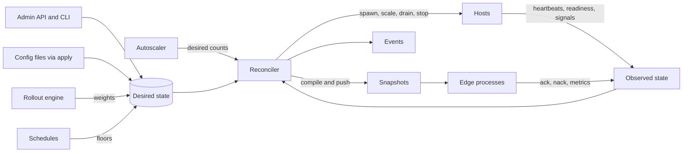
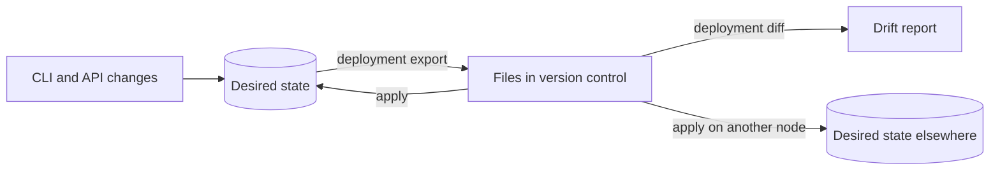

# 10. Control plane

```{admonition} Design specification
:class: note

This page is part of the Muru design specification and describes intended
design, for contributors. The user documentation is authoritative for released
behaviour. See the [specification index](index.md) for status and how the
specification is maintained.
```

The controller stores desired state and continuously drives observed state toward it. Imperative commands, declarative files, schedules and rollouts all change desired state; only the reconciler acts. The dashboard shows desired and observed state and changes neither (section 10.7).

## 10.1 Reconciler



The reconciler is level-triggered and idempotent: each pass compares desired and observed state per object and issues the minimal actions, so a restart in the middle of a deploy simply continues.

## 10.2 State store, persistence and recovery

- SQLite in WAL mode in the state directory (section 13.8), holding desired state, release records, rollout history, events within retention, the audit log and the period each log file was last seen in (section 11.3). Schema migrations are forward-compatible for one version, so a failed daemon upgrade can be reversed.
- Each host is started with a random token and a run directory containing its control socket. After a daemon restart the daemon scans run directories, verifies tokens and process start times, and re-adopts hosts. Hosts not in desired state are drained and removed after a grace period.
- muructl daemon backup and restore save and load the whole store.

## 10.3 Configuration files

- The daemon configuration file (found as described in section 13.8) holds node settings: listeners and edge pools, paths, budgets, tools, event sinks, admin access. It is re-read with muructl daemon reload or SIGHUP.
- **Details fixed by the implementation.** The file is read the same way at start and on reload, checked whole, and the reload applies what changed, each table in its own way. The edge's tables (`[proxy]`, `[compression]`, `[error_pages]`, `[error_override]`, `[[client_class]]`, `[rate_limit]`, `[limits]`, a listener's `h2c` and the access log keys of `[logs]`) go to the edge in the next snapshot, which carries the limits (section 4.6) and the access log's filter (section 11.2) as it carries the rest; a connection already open keeps the limits it was accepted under, and the listeners' connection limits and the spool's quota change at once. A changed set of `[[listener]]` entries starts a new edge on the new listeners and stops the old one as section 13.4 does, a kept listener keeping its socket and backlog; the new listeners are bound before anything is applied, so one that cannot be bound fails the reload with nothing changed. `[[events.sink]]` entries are started, stopped or restarted by name, each on the cursor the store keeps for it, so a sink that comes back delivers what it missed. The budget and the secret stores (section 10.8, consulted when a release starts) are swapped in place, and the log rotator takes the new `[logs]` policy for its next check (section 11.3), a changed period rotating each file once. The `[metrics]` table, the dashboard's listen address, `[overlay_webhook]` and the daemon's user are read at start, and the command line's `--listen`, `--metrics`, `--dashboard` and `--user` stand over the file on every reload. The reload's answer and the `config.reloaded` event name what changed and what was done about it, what is unchanged, what could not be applied and what is read at start.
- What the daemon serves is changed through the CLI and API, or applied from files (muructl apply -f FILE or DIR, and -f may be given more than once). Files are applied as written: there is no interpolation of variables (ADR 0079, issue 939). A directory that holds a pyproject.toml or a project's muru.toml is refused with a message naming the file to give.
- **Which file takes which table (ADR 0079).** There are three kinds of configuration: a project's settings (section 6.8), the daemon's configuration and deployments (section 10.13). Each table belongs to one. The daemon's file takes `[daemon]`, `[tools]`, `[[listener]]`, `[limits]`, `[proxy]`, `[compression]`, `[secrets]`, `[logs]`, `[logging]`, `[shutdown]`, `[metrics]`, `[events]`, `[dashboard]`, `[overlay_webhook]` and the node-wide `[error_pages]` and `[error_override]`. Applied files take `[app.NAME]` and its releases, `[host.NAME]`, `[[route]]`, `[upstream.NAME]` and `[overlay.NAME]`. Each reader refuses the other's tables as an error that says where they go: the daemon does not start or reload with a deployment table in its file, and an apply fails on a daemon table. `[[client_class]]`, `[rate_limit.NAME]` and `[condition.NAME]` are the one overlap: the daemon's file defines them for the whole node, a deployment uses them and defines its own, and a name defined in both is one uniform error. A deployment may name what the daemon's file defines; the daemon's file never needs anything a deployment defines in order to load or to run, and a condition there that names an application or an upstream in a signal's labels only filters figures.
- **The daemon's file has commands of its own (issue 894, ADR 0079).** `muructl daemon config path`, `show`, `check [FILE]`, `edit`, `set`, `unset` and `replace FILE`. `edit`, `set` and `replace` check the result with the code the daemon reads the file with, write it atomically and have a running daemon reload, and say which settings are read at start; they warn when a flag the daemon was started with stands over a key they changed. `check FILE` resolves the file's relative paths against its own directory, and `replace FILE` against the directory of the daemon's file, where the file is going; `replace FILE --check` tests a replacement. The full form of `show` is a valid file. A file changed by other means is checked with `check` and applied with `muructl daemon reload`.
- **A start and a reload read the file the same way.** A start that adopts a running edge and hosts (section 13.4) applies the file it was given as a reload would, replacing the edge when the listeners differ.
- The schema is versioned (schema_version at the top of each file), validated before apply, and published as JSON Schema for editor support, one schema for the daemon's file and one for applied files, as the reference has a page for each.

## 10.4 Export, diff and apply



- Export writes desired state only, never observed state. Applying an export to its source produces no changes.
- Options: one deployment by name, --dir DIR for one file per deployment, or --app with --as NAME (section 10.13), --resolve-rollouts, --redact, TOML or JSON.
- Export writes a release the daemon has, with its settings spelled out whether or not they are the defaults and its interpreter as the path it resolved to, so that the file applies back to the daemon it came from without a change (ADR 0052). It writes each application's serving release and every release that a route it writes names in its traffic split or client classes, so that the file also applies to another node, where `serving` starts those releases held; it leaves out a release that neither serves nor is named. Where each of those settings came from is what `deployment show --effective` reports (section 3.3).
- Secrets are exported as references, never values. Output is deterministically ordered with a header naming version, node, time and state version.
- apply supports --dry-run (below) and --prune, which removes objects that the files no longer contain. A prune that would remove a release a route the files keep names in its traffic split or client classes, or the application such a route names, is refused, naming the route and what it names. --prune reaches the deployments the files name, and --prune=all every deployment (section 10.13). For an application the files declare, a prune treats each release they do not declare by where it stands: one that serves refuses the whole apply, the rollback release is skipped, the plan saying so, until a later prune finds it no longer the rollback release, and any other is removed (ADR 0082). A plan names each setting an apply removes from an application, since a file states the application's table in full.
- apply takes the flags that say how a release is deployed, as muructl deploy does, and they act on every release the apply adds, in every application: --hold starts them and leaves traffic where it is, --no-wait returns once they are recorded and leaves the rest of the apply to follow once they start (section 10.10), and --retain and --retain-workers say how long, and with how many workers, a release one of them replaces, or a promotion takes over from, stays warm. A plan and a report say `held` of each release started that way, and a dry run says what becomes of each release that would be replaced. A file has no key for any of them: they describe the act of applying, not the state applied (ADR 0052).
- An application's `serving` key names the release that serves its traffic, a declared release or one the daemon has; naming neither is refused (ADR 0054). The other releases the apply adds are started held when a route's traffic split or client classes in the same files name them, serving only that share and previews, or an overlay there pins them, splits to them or waits on them with release_ready, so that it can activate, and are otherwise recorded and left stopped, for a rollout, a promotion or a route split to start later; --hold starts every one held, as it does a deploy. Naming a release the daemon has that does not serve plans a `promote`, the switch and drain of a blue/green promotion (section 9.2), written with the hosts, routes and overlays and reaching the edge in the same snapshot (section 10.10), so that a split the same files write keeps the releases it names. Without the key, an apply that adds one release of an application gives it the traffic, and an apply that adds more than one is refused until the key says which serves: the order of ids decides nothing, since an id such as a commit has none (ADR 0082). Only a release the daemon does not have counts as added. --hold with a key that would move traffic is refused. While a rollout is under way the key may name its baseline or its candidate, and the rollout moves the traffic: nothing is promoted, naming the baseline warns that applying the files again after the rollout promotes would promote the baseline back, and naming another release is refused until the rollout is promoted or aborted. A promotion of a release whose latest rollout rolled back, by its gates or by hand, is refused, naming the rollout's message, until the files name another release or the release is promoted by hand with muructl rollout bluegreen, after which the files agree with the daemon and plan nothing. The same holds after muructl rollback: an apply whose key names the release rolled back from is refused, naming the rollback, until the key names another release or that release is promoted again by command, so that an apply, or a start that applies files (section 13.13), never puts back in traffic a release someone took out of it. Any other move of traffic away from a release a command made serving is allowed, and the plan says that it is one: the store records how the serving release was last set. With --prune, the release that serves after the apply, by the key or without it, must be declared, or the plan refuses. Export writes the key for each application with a serving release. A plan's deploy says `serving`, `held` or `stopped`, and a promotion names the release it takes over from.
- muructl render APP [SOURCE] writes the release a command line describes as an `[app.APP.release.ID]` table of this format, for a file kept in version control or given to apply. It takes the settings muructl deploy takes for a release, defined once for both commands, and none of the flags about how a deploy is carried out or where a daemon is. It contacts no daemon. --release ID is required: an id for a file is the author's to choose, a date or a commit, and a default made two renders into one file a release declared twice (ADR 0079). --deployment NAME writes the `deployment` key (section 10.13) at the top, for a file that holds one release, and is left off when appending to a file. --metadata and the keys filled from git are taken as muructl deploy takes them (section 9.14). Each setting comes from the flags, then the source's own settings, then the defaults, and never from an earlier release or the application's settings, so applying the table gives the release a deploy gives for the same flags to an application with no settings of its own. A setting left at its default is not written; --full writes every setting a flag can set, with a comment beside each naming the command line, the source's settings or the default, and names those that are off unless set. The source is written as the command line gives it, and a relative one is taken from the file's directory when applied. The interpreter is written only when a flag or the source's settings name one, since the path it would resolve to here is not the node's: the daemon finds it at the apply, as it builds an environment the release needs. Secrets are written as references. What a deploy would refuse is refused and nothing is written. --json writes the same document as JSON (ADR 0052).
- A file in this format kept beside a project's code is named `muru.deploy.toml` by convention, since `muru.toml` there is the project's settings file (section 6.8), which has other keys and is read from a release's source, and the file holds releases and not the daemon's settings (ADR 0079, which renames the `muru.daemon.toml` of ADR 0051). A project's settings file refused for a key of this format says what the file was taken for and names the convention. A release's table needs only its `source` there, since what it leaves out comes from the source's own settings.

**Dry runs and plans.** muructl apply --dry-run reports what an apply would change and what the system would do about it, without changing anything. The report has four parts:

1. **Validation:** schema errors, unknown keys and type errors with file and line; broken references (routes to missing applications or upstreams, release paths or images that do not exist, undefined mounts, groups or accept_redirects_from targets); and conflicts (duplicate host names, overlapping group paths, overlays writing the same field without priorities, inconsistent timeouts such as a hard timeout below the soft timeout).
2. **Diff:** objects added, changed and removed (removals only with --prune), with field-level differences, the layer each value comes from, and secrets redacted.
3. **Plan:** the actions the reconciler would take, grouped by disruption.
4. **Impact and warnings:** whether new releases or variants fit the node's memory budget (estimated from comparable running releases), deploy freezes that would block part of the apply, active overlays that would mask a change while they last, running rollouts the change would pause or conflict with, and anything the dry run cannot verify.

| Plan class | Examples |
| --- | --- |
| Live, no disruption | route, limit, proxy, error page, weight and certificate changes, applied in the next snapshot |
| Scaling | workers to fork or drain, schedules to activate |
| Rolling restart | thread counts, max_requests, memory policy or hook changes, per group, with the max_surge that will be used |
| New release | code, interpreter, environment, entrypoint or mount changes, including any build step and how traffic would move under the application's default strategy |
| Removal | releases, routes or hosts to drain and delete (only with --prune) |

muructl deploy --dry-run asks the daemon the same of one deploy: the id the release would take, each setting with the layer it would come from (the flags, the application's settings, the source's settings, or the default), whether an environment would be built, what becomes of the release that serves, and what would refuse the deploy: an id already taken, a deploy freeze, a setting that fails its check or a release the node's memory budget has no room for. It installs nothing, so an interpreter a deploy would fetch is reported as missing. A deploy always plans a change, so its exit code is 0 when it would go ahead and 1 when it would be refused.

What a dry run cannot know, such as whether new code imports cleanly, is listed explicitly. --check additionally runs muructl check on new or changed releases in throwaway hosts.

For scripts and CI: --json gives the same report in machine-readable form, and the exit code is 0 for no changes, 2 for changes planned and 1 for errors; after an apply it is 1 when a release did not start, and nothing was applied, when a change failed, or when the edge did not take the snapshot that carries the changes, which the report names. --save-plan FILE records the plan with the state versions it was computed against, and muructl apply --plan FILE applies exactly that plan, refusing if desired state has changed since. This supports a reviewed workflow in which a pull request's plan is produced in CI, reviewed and then applied unchanged.

- **Details fixed by the implementation.** `--resolve-rollouts` writes each rollout under way (running, paused or awaiting approval) as where it stands, since rollouts are not declared in files: the candidate and the baseline are both declared, and each of the application's routes gets a traffic split giving the candidate its share in force and the baseline what the route's other shares leave, so the file gives the same split whichever release ends up serving after an apply. A rollout that has ended is not written.

## 10.5 What changes live

| Change | Mechanism | Disruption |
| --- | --- | --- |
| Hosts, routes, weights, limits, timeouts, error pages, proxies, certificates | snapshot swap | none |
| Worker counts, scaling settings, schedules | host forks or drains | none |
| Thread counts, max_requests, memory policy, hooks | rolling worker restart per group | none, bounded by max_surge |
| Code, interpreter, environment, entrypoints, mounts | new release | none |
| Edge pools and process counts | edge processes added or replaced with handoff | none |
| Edge or daemon binary | handoff or re-exec | none to traffic |
| New listener address | daemon creates socket, edge adopts it | none for existing listeners |

## 10.6 Admin API and access

- gRPC service muru.admin.v1 on the admin Unix socket (owner and group restricted), optionally over TCP with mTLS. A JSON gateway serves what the dashboard shows, read-only, for the dashboard and scripts. Appendix B lists resources and operations.
- Roles: read, deploy and admin. Socket access maps local users to roles through group membership. TCP access maps client certificate subjects or bearer tokens to roles.
- Every mutating call carries an idempotency key, is checked against resource_version, written to the audit log with the caller's identity, and emitted as an event.
- The `.proto` files of the API are given out by the binary (issue 858), so a client outside Muru generates its stubs from exactly the release installed, offline and with no tag to map from the PyPI version. muru-proto embeds `muru/admin/v1/admin.proto` and whatever it imports, never muru.worker.v1 or muru.edge.v1, which are Muru's own, and its build script compiles them to a `FileDescriptorSet` with the imports included. `muructl proto export DIR` writes the files beneath DIR by package, so `protoc -I DIR` resolves the imports, each with three comment lines in front recording the muructl version and the SHA-256 of the body, and `--descriptor-set FILE` writes the set for grpcurl, buf or a gRPC-JSON transcoder. `muructl proto status DIR` compares the files with the binary's as `muructl mcp skill status` compares the skill (section 10.11): current, missing, out_of_date, edited or edited_out_of_date, exiting 1 unless current, so a client that commits its files and stubs checks an upgrade in CI. `muructl proto print [PATH]` and `muructl proto list [--json]` complete the group. The same files serve every mode, since the daemon, muructl run and muructl serve all serve muru.admin.v1. Rejected: the files as package data (the muru package is imported by every worker, where they are of no use), an asset on each GitHub release (needs the network and the version mapping), gRPC server reflection (stubs are built from files ahead of time) and vendoring a copy (it drifts). A grpcio client over the Unix socket must set `grpc.default_authority`, since the h2 server refuses the authority grpcio makes from the socket path (issue 901).

## 10.7 Dashboard

Browsers cannot speak native gRPC, so the dashboard uses the JSON gateway: plain HTTP with JSON and Server-Sent Events, served by the same process as the admin API. Pages are rendered on the server from Rust templates (askama) and kept live with htmx and its Server-Sent Events extension, fed by the Watch streams. Charts use uPlot. htmx and uPlot are small JavaScript files vendored into the repository and embedded in the binary, so building the dashboard needs only cargo, with no Node toolchain or bundler. A minimal read-only dashboard is available in muructl run from phase 1 (workers, requests per second, latency, recent requests and logs), and grows with each phase. If richer client-side interaction is needed later, individual views can move to a small component library such as Preact without changing the gateway. The dashboard shows and never changes, in every mode (ADR 0060): it has no actions, its JSON paths under `/v1/` read and never change, and a view added later brings no form with it, since a change belongs in a `muructl` command; whatever it shows is reachable from `muructl` as well. Under the daemon every page needs a signed-in session (ADR 0030). Views: overview, applications and releases, the processes (section 13.10), hosts and workers with scaling signals and decisions, routes and rollouts, drains and events, throughput charts from in-memory history (1 hour at 1 second, 24 hours at 1 minute), and logs. It binds to loopback or the admin socket by default and is served with a strict content security policy.

- **Details fixed by the implementation.** Authentication rests on the admin socket: `muructl dashboard login` calls DashboardLogin, which issues a random single-use code good for five minutes and answers with the link `/login?code=` on the dashboard's address, or under `--url` (or `MURU_DASHBOARD_URL`), and redeeming it sets the session cookie `muru_dashboard` (HttpOnly, SameSite=Strict, no Path, twelve hours) and answers 303 to `./`, or to `./NEXT` when the link carries `next=NEXT`, a relative path under the dashboard of letters, digits, `-`, `_`, `.` and `/`, not starting with `/` and with no `..`, which `muructl open --dashboard --request ID` gives as `request/ID` (issue 815); anything else in `next` is ignored, so the link never sends a browser elsewhere. `muructl open --dashboard` calls DashboardLogin as `muructl dashboard login` does and opens the link, so the browser is signed in; the link passes through the launcher's command line, which the user documentation says, and is single-use and good for five minutes. The node page lists each application's addresses, best first, from the same ranking as ApplicationUrls. `--token` opens a session at once and prints its id, which a script sends as `Authorization: Bearer`. Sessions live in the daemon's memory, so a restart ends them. Every path needs a session except `/login`, `/metrics` and `/static/`; without one, `/` answers 401 with a page saying how to sign in and the rest 401 in plain text. The pages' addresses, the charts' requests and the redirects are relative, so the dashboard works under any path prefix. Only GET and HEAD are served, so a POST to any path is 405, and the pages carry no forms; their policy adds `form-action 'none'` and `frame-ancestors 'self'`, so a page of the same origin, such as Jupyter's through jupyter-server-proxy, may show the dashboard in a frame and no other site may. The worker inspection views (section 11.7) are `/workers?release=APP@RELEASE`, the release's workers as `debug status` lists them, refreshed every two seconds, with their stacks merged as `debug stacks` merges them, and `/worker?release=APP@RELEASE&worker=N` (`worker=GROUP/N` outside the default group), one worker's status, stacks and tasks, with its memory on request, since counting its objects holds the interpreter; each asks the workers through the reconciler as the Debug call does, with the same waits, so a memory view is a `debug.memory` event as the command is. The fragments `/fragment/workers/OP` and the JSON `/v1/debug/OP`, for `status`, `stacks`, `tasks` and `memory`, take the same `release` and `worker` parameters; the JSON is shaped as `muructl debug --json` prints it, and a release that is not running is 409 to a script and a sentence in a page. The Processes section is the fragment `/fragment/processes` and the JSON `/v1/processes`, in every mode, from the ListProcesses answer `muructl status --processes --json` prints. Issuing a link or a token is a `dashboard.login_issued` event. `muructl run`'s dashboard needs no session.
- **The request page of a development run.** `/request/ID` shows the run's record of one request (section 11.7): an askama shell holding the same panels the development toolbar shows (section 4.20), drawn from their minijinja templates and sanitised (ADR 0063), so the two cannot drift apart. `/v1/requests/ID` is the record as JSON, shaped as `muructl debug request ID --json` prints it. A request no longer kept is 404, with a sentence on the page and `{"error": ...}` to a script. The recent requests rows link to the page, and `Muru-Request-Link` on each response names it. The command and the MCP `debug` tool's `request` read the record through the run's admin socket (GetRequest); the daemon and `muructl serve` keep no records and answer that a development run keeps them.

## 10.8 Secrets

Applications need credentials, and the configuration model refers to them by name so that exports, events, logs and dry runs never contain their values.

- **Stores.** Secret stores are declared in the daemon configuration, each with a name and a kind: file (a directory of files readable only by the daemon), env (variables in the daemon's own environment, for container and CI deployments), or exec (a configured command that prints the value for a given key, used as the adapter for Vault, cloud secret managers or the 1Password CLI).

```toml
[secrets.store.local]
kind = 'file'

[secrets.store.ci]
kind = 'env'

[secrets.store.vault]
kind = 'exec'
command = ['/usr/local/bin/vault-read', '{key}']
timeout = '5s'
```

- **References.** Configuration refers to a secret with a structured value naming the store and key, in the same style as every other setting:

An application's own variables and secrets go in `[app.NAME.env]` in the same form, and every release deployed after the apply takes them under its own (section 3.3, issue 899).

```toml
[app.shop.release.r42.env]
DJANGO_SETTINGS_MODULE = 'shop.settings'
DB_PASSWORD = { secret = { store = 'local', key = 'shop-db-password' } }
API_KEY = { secret = { store = 'vault', key = 'shop/api-key' }, as = 'file' }
```

- **Delivery.** By default the value is delivered as an environment variable. With as = 'file', it is written to a file under the release's run directory with mode 0400 owned by the application user, and VAR_FILE holds its path, following the NAME_FILE convention. The host's files are removed whenever it stops for good or goes idle, and written again at its next start; a detaching daemon leaves them for the host still serving. A command run with the release (section 9.12) writes its own under RUNTIME/apps/APP/RELEASE/commands/N, removed when it ends. Values are resolved when a release is created and are part of the release's identity: rotating a secret means a new release, which gets the usual drain and rollback.
- **Handling.** Values are held only as long as needed, never written to the state store, exports, events, logs, dry-run output or diagnostic bundles, and never passed on a command line. Exports and diffs show the store and key. muructl secret set, list and remove manage file stores; list shows names only.

## 10.9 Per-application users and isolation

```toml
[app.shop]
user = 'shop'
group = 'shop'
umask = '027'
limits = { nofile = 65536, memory = '4GiB', cpu = 2.0 }     # cgroup limits on Linux
```

- **Data and static directories (issues 849 and 850).** The application's data directory and its media and uploads parts are made, when missing, owned by the application's user with mode `0700`, before a release's host or command starts; Muru changes nothing of one that is there, and does not refuse a release whose user is not its owner, which fails where its code cannot write and which `muructl data show` makes visible. The media part is a root marked with the application's user (section 4.9), so a link in its place must lead to a directory that user owns. A release's static directory is owned by the release's user with the edge's group, mode `2750`, set again at each start, so the edge reads what `collectstatic` writes there and no other application's user does, and what is made in it keeps the group, as the release's socket directory is shared.
- When the daemon runs as root, each application's hosts and workers run as the configured user and group, or as the service user (ADR 0026: `muru`, or the `[daemon]` table's `user` or `--user`) when the application names none; never as root unless `user = 'root'` is written, which records an `app.user_is_root` warning at each release start. Its `HOME`, `USER` and `LOGNAME` are the user's own (section 8.7). The release's run directory and socket directory are owned by that user, with the edge's group given access to the sockets only. Without root (user mode), everything runs as the daemon's user and a configured user is reported as not applied.
- The daemon creates no accounts. A root daemon whose service user does not exist, or is root, refuses to start and names the remedies. The packages ship a sysusers.d entry for `muru`.
- limits map to per-release cgroups on Linux (section 8.5 describes the container equivalent). cgroups are created by the daemon under its own slice, and delegated by systemd when the unit runs under it.
- Applications never see each other's run directories, spool directories, bytecode caches, data directories or secrets, and cannot reach the admin socket unless their user is in the admin group.

## 10.10 Atomic apply

An apply is validated as a whole, and files with an error apply nothing. It is then carried out in two phases (ADR 0055):

1. **Prepare.** The applications the files add are created, with the identity and priority their processes start with, and the releases they add are recorded, each started held or left stopped as the plan says (section 10.4). A release a promotion names that does not run is started held too. Nothing points at them yet: no host, route, overlay or promotion is written, and traffic stays where it is. A release that does not start stops the apply. The releases the apply recorded are removed, a release the daemon had that it started is stopped again, the identities and priorities it set are put back and the applications it created are removed. The report says nothing was applied, naming the release and why, and a `config.apply_failed` event records it.
2. **Commit.** The hosts, routes, upstreams, overlays, client classes, rate limits, access-log choices and applications' release settings (section 3.3, issue 899), and the release that serves each application, are written in one transaction of the state store. The releases the routes' traffic names that do not run are started, and then one snapshot gives the edge all of it, so a promotion's traffic switch reaches the edge with the routes the same files write. The releases that served before then drain, and with --prune the releases and applications the files no longer contain are drained and removed. A `config.applied` event counts the changes.

What the apply guarantees:

- Routes and traffic change all at once or not at all, so a change that adds a host, a route and a release cannot leave a route pointing at a host that does not exist or at a release the apply added that has not started.
- Applies happen one after another. An apply given while another is under way, a --no-wait one the daemon is still finishing included, waits for it to end and is then planned against the desired state it left, and its report says it waited.
- An apply, once planned, is carried out by the daemon. A client that goes away while its releases start, interrupted or disconnected, stops only the report: the daemon finishes the apply, or undoes the prepare phase when a release does not start, as it does after a --no-wait apply.
- A daemon restart cannot leave half of the configuration written. Before the commit's transaction only the prepare phase's records are written, and after it all of the rest is. The daemon builds its first snapshot from desired state when it starts again.

What it does not guarantee:

- The edge can refuse the snapshot. The changes are then in desired state, and the apply exits 1, naming the edge's reason (section 10.4).
- A restart between the phases leaves the releases the prepare phase started recorded and held, and nothing else written. Applying the files again finds the releases and commits the rest.
- A release the daemon had stopped that a written route's traffic names is started in the commit phase and can fail to start. The apply still lands, with a `traffic_policy.release_unavailable` event, as for any policy that names a release that cannot run (section 9.4).
- The prepare phase pushes a snapshot as each held release starts, so that it can be previewed. None changes where a request without the preview header goes.
- The drains and removals after the commit are not in its transaction. One that fails is a failed change in the report, and the apply exits 1.
- With --no-wait the apply answers once the releases are recorded, and the daemon carries out the rest. The `config.applied` or `config.apply_failed` event says how it ended.
- A dry run and a diff do not wait for an apply under way, so they may plan against desired state that apply has yet to commit.

## 10.11 An MCP server for coding agents

`muructl mcp serve` gives a coding agent the daemon's operations as tools over the Model Context Protocol, on standard input and output, so an agent can deploy each change as a release, test it, read what Muru observes and roll back or drain (ADR 0039). A project lists it in its MCP configuration (`.mcp.json` for Claude Code) as `muructl mcp serve`, with `--up` to start the user daemon when none answers.

- Each tool runs the matching muructl command with `--json` against the same daemon, with the server's `--socket` and location options, and returns what it prints; the instance is settled once at start from the same sources as any command's (section 13.8): the server's own `--socket` or `--instance`, else `MURU_INSTANCE`, else `instance` in the muru.local.toml of the directory it starts in, which it passes on as `--instance NAME`, so every tool reaches that instance unless a call gives its own `instance` argument, any value `--instance` takes (section 13.8, issue 868), for that call alone; a command that fails makes the tool return its error's sentence as a tool error. Results therefore have the shapes of the JSON output reference, which every command that reports something shares (`--json` prints the admin API's answer with its field names, JSON lines for streams, `{"error": ...}` on failure).
- The tools are few and shaped like tasks: status, processes (the process tree of section 13.10), instances (`muructl instance list --json`, the instances on the machine and with `orphans` what they left behind, run on this machine whatever instance the server reaches, section 13.8), list (one kind of object), release, commands, events, logs, debug (status, stacks, tasks, memory, inspect, the last without `--env`, so environment values reach the agent only for Muru's, the interpreter's and the release's variables, and request, a development run's record of one request by its ID), scale status, config (show, diff), metrics, websockets, overlay preview and detours (the list, and an entry link to a detour's preview, section 9.13) read; deploy, promote, rollback, drain, rollout, scale, run command, restart, overlay, maintenance, apply, log level, access log, reopen logs, reload config and detour traffic change things. Stopping, shutting down or upgrading the daemon, running code in workers and one-off commands are not offered; run command runs only what an application declares (section 9.12), and refuses a secret input given as a value, which must name a secret store entry instead. A docs tool returns pages of the user guide embedded in the binary.
- Streams become bounded snapshots: events after a sequence number, the last lines of a log.
- Standard error, which clients keep as the server's log, carries one start-up line naming the socket served (the daemon's, a development run's, or another) and the tools offered, and a plain warning for each call refused, a tool not offered being a protocol error to the client; the MCP library's own events are kept to warnings by muructl's default filter (`info,rmcp=warn`), its warning echoing each refusal in Rust's debug form left out.
- `--read-only` leaves out every tool that changes something; `--allow TOOL,...` keeps only those named. Both are enforced by the server, since the protocol's read-only and destructive annotations, which every tool carries, are advisory.
- The initialize response's instructions carry a short model of Muru's objects (application, release, traffic, rollout, overlay, apply against deploy, and that only the reconciler acts).
- Whoever launches the server has the admin socket's access; for a developer's user daemon that is the intent. Remote agents, and applications acting on their own instance, wait on the TCP admin listener and its access model (section 10.6), with a streamable HTTP transport.
- A skill the project carries, printed and installed by `muructl mcp skill`, teaches what the tools cannot: the development loop, what each operation does to traffic, and what to check after each. Its front matter records the muructl version and a SHA-256 of its body, so `mcp skill status` tells five states apart: `current`, `missing`, `out_of_date` (another muructl's skill, unchanged), `edited` (the body no longer matches its recorded hash) and `edited_out_of_date`; `install` refuses to overwrite an edited copy without `--force`, and project notes belong in a skill of their own or `CLAUDE.md`.

## 10.12 The detour calls

The admin API's calls for detours (section 9.13, ADR 0075) are on the admin socket only, with its access (section 10.6); a development run's and a serve's admin socket refuse them as daemon calls.

- **OpenDetour** is a server stream. The request names the application, the run's socket, its label, its instance ID, pid and directory (the checkout), and the traffic wanted. The daemon refuses it when detours are off or it is a system daemon, when the application does not exist or has no serving release, when the socket is not a Unix socket the daemon can connect to, and when the traffic is refused (section 9.13). Otherwise the first message names the release, its data directory, the traffic in force, and the serving release the detour stands in for, as `app@release`, with its named mounts (name, path, interface and entrypoint), which the run compares with its own or serves with (issue 907); the application's host names are no longer sent (issue 911); later messages carry each traffic change. The release lasts until the stream ends from either side; the daemon ends it when it stops, saying so in a last message.
- **ListDetours** gives each open detour: the application, the release, the label, the run's instance ID, pid and directory, the traffic, its paths (issue 909) and when it opened, never the secret. OpenDetour's request carries `paths`, the client URL paths the detour takes requests under, and SetDetourTraffic's `paths`, which replace the detour's when given, and `all_paths`, which clears them; with neither the paths stay as they are.
- **SetDetourTraffic** changes the traffic of the detour its application and release name. muructl and the MCP tool choose the detour from ListDetours (`muru_controller::detours::choose`): its release, then its application when one detour has it, then the resolver of section 13.8 over the detours' runs (the tag, a prefix of the instance ID, the label), an ambiguous value refused with the value to pass for each, and with no value the project's application in a checkout, else the one detour open.
- **PreviewDetour** mints entry links for a detour named the same way: one for the application's best address, as `ApplicationUrls` ranks them, one for the address on a host asked for, or one for each address, from the name asked for when one is (issue 908); each link carries its name and the listener's bound address, so the client keeps those that reach its machine. An application with no address is answered with no links, the reason in `unreachable` and the header still, since the header needs none; each link is a token the daemon has given its edges (section 4.21), valid for a minute. It also gives the `Muru-Preview` header value, `RELEASE.SECRET`, and how many other addresses there are.

## 10.13 Deployments

What the daemon serves is held in deployments (ADRs 0080 and 0082).

- **A deployment is a named set of objects applied together.** A `deployment` key at the top of a file names it. Each object an apply creates records the deployment that owns it: applications with their settings and releases, hosts, routes, upstreams, overlays, and the deployment's own client classes, rate limits and conditions. There is always a deployment named `default`: files with no key belong to it, and so does what commands make, except that a release made by muructl deploy belongs to its application's deployment. A node with one set of files, or none, names nothing.
- **Names stay node-wide.** A route in one deployment may name a host, an application or a class in another, and any deployment may put a route on any host. Ownership says who may change a thing, not who may refer to it.
- **Only the owner changes or removes its objects.** An apply that declares an object another named deployment owns is refused, naming that deployment. A named deployment takes an object from `default` by declaring it. Nothing moves an object between two named deployments or renames a deployment (issue 929).
- **Nothing is removed while something that stays names it.** A removal, by muructl deployment remove or a prune, is refused while an object that stays refers to what it would remove, whether another deployment holds that object or the files of the same apply declare it. The rule is one check over the whole plan, for every way one object names another: a route its host, what serves it, falls back for it and decides for it, its client classes, its rate limits and the releases of its traffic; a host its rate limits; a rate limit and a release's worker groups their client classes, and a group its hosts; an overlay its condition, its applications, its routes by name, and what its changes to them name. A condition's labels are not references. Two deployments may not declare a route for the same host, path and class.
- **One apply may carry several deployments.** The files given are grouped by their key, files with the same name merging into that deployment, planned together and applied all or nothing (section 10.10).
- **Prune has two levels.** --prune reaches the deployments the files name. --prune=all reaches every deployment, `default` included, so a deployment the files do not mention and an application made by command and in no file are removed; it is not refused when such an application is serving, and the plan lists what is drained. It is how a set of files is made the whole truth for a node.
- **Commands.** muructl deployment list, show [NAME], diff -f PATH, export and remove NAME; the group replaces muructl config. remove drains what the deployment runs after listing it and asking (--yes, --dry-run, application data kept unless --data), is refused as above, and may name `default`, which it empties and leaves in place. With --data the list says each application's data directory and what it holds. show NAME prints one deployment as its files would state it, and --app APP one application. The lists of applications, hosts, routes, upstreams and overlays carry each object's deployment in the admin API, print it as a column once any object belongs to a named deployment, and take --deployment NAME to list one deployment's.
- **Export.** export NAME writes one deployment with its key, `default` without one. With no name it writes `default` when no named deployment exists and is refused when one does. --dir DIR writes one file per deployment into an empty directory, which applies back unchanged. --app APP writes one application with the routes that reach it and their hosts, and --as NAME writes a `deployment` key at the top. What the daemon's file defines is not exported.
- **An application is the files' or the command line's.** One that applied files declare gets its releases and its settings from them; one that no file declares gets them from muructl deploy and muructl app set. A deploy on a declared application works, for an emergency, and always warns that the release is not in the files and what the next apply does with it. muructl app set and unset are refused on an application a named deployment owns, and in `default` app set warns when the settings were last written by an apply. A route in a file may name an application no file declares.
- **An application's own settings are declared in one file of an apply.** A second file that sets any key of `[app.NAME]`, `env` among them, is refused, as a host declared twice is. Releases of one application add up across files.
- **A deployment file is written for one node.** `[app.NAME]` is the home of what belongs to this node (section 3.3). Nodes that share most of a deployment split it across files with the same key.
