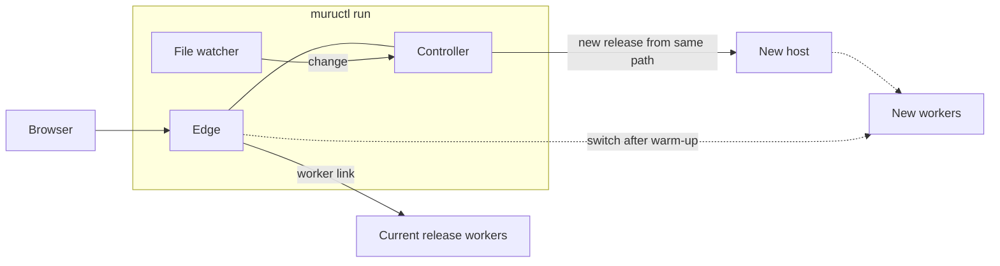
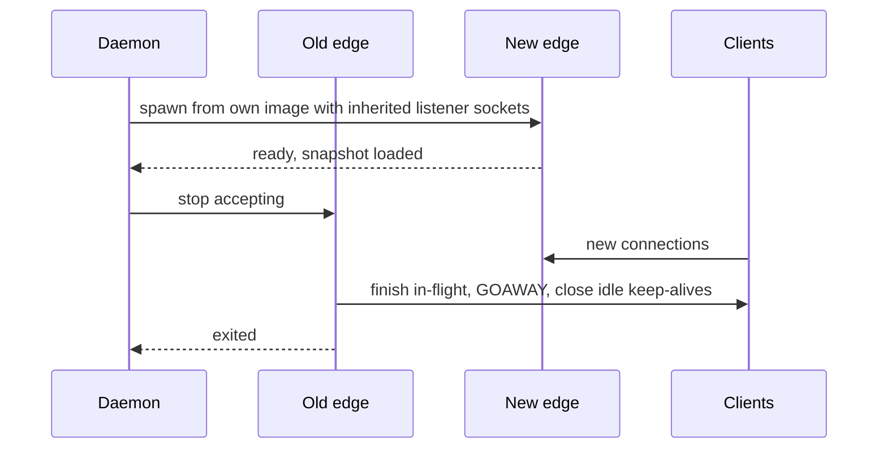

# 13. Operations

```{admonition} Design specification
:class: note

This page is part of the Muru design specification and describes intended
design, for contributors. The user documentation is authoritative for released
behaviour. See the [specification index](index.md) for status and how the
specification is maintained.
```

The same components run in every setting, from a laptop to a production node. Development mode embeds the controller and edge in one process; production runs them as a daemon with separate edge processes.

## 13.1 Development mode

```
muructl run                                        # uses [tool.muru] and [tool.muru.run] in the current project
muructl run shop.wsgi:application --no-reload
muructl run myapp.main:create_app --factory --python 3.13
muructl run ./myproject --processes 2 --threads 8 --bind 127.0.0.1:9000
muructl run app:app --single                       # one process, one thread, no fork, for debuggers
muructl run --build                                # bring .venv up to date with the lock first, then serve
```

- No daemon, root, state store or systemd, and nothing of Muru's written into the project directory (locations in section 13.8; the project's own `.venv` that a build makes is uv's, section 8.2). Controller and edge run as threads of one process, hosts and workers as children. Loopback only, HTTP on port 8080 by default, HTTPS on 8443 when enabled (below). Loopback peers are trusted for the forwarding headers of section 4.7, X-Forwarded-Prefix included, so a development proxy that mounts the application under a path (jupyter-server-proxy, code-server) sets SCRIPT_NAME or root_path with no [proxy] table; the same holds under --allow-public, for loopback peers only. Their headers alone are trusted: a loopback peer keeps a client's connection share and timeouts (section 4.18), since it is as often a browser as a proxy.
- **Development mode is said out loud.** Start-up prints that error pages show tracebacks, nothing is persisted, the run reloads on change and only loopback is served, and the dashboard header says development mode, so nobody mistakes muructl run for a production setup. A --bind address outside loopback is refused with a message naming the daemon as the production path. --allow-public serves it anyway with the development behaviours off (no tracebacks in error pages, the 10 MB body limit of ADR 0008, no HSTS warning, no dashboard unless asked for) and a start-up line saying this is still not the supported way to run in production; it exists for trying Muru behind real clients before the daemon exists, and in containers whose port mapping needs 0.0.0.0.
- The argument is an entrypoint (module:callable) or a project: a directory, or its pyproject.toml or muru.toml, whose [tool.muru] table names the entrypoint (section 6.8). With no argument the project is --chdir or the current directory. A flag wins over the table, the table over the defaults. An entrypoint given on the command line replaces the table's entrypoint together with its factory and factory_phase settings, since those describe the entrypoint; processes, threads, preload and hooks still come from the table. --static PREFIX=DIR adds to or replaces the project's [[tool.muru.static]] entries by prefix, served by the edge as section 4.9 describes. Interface detection from the callable.
- **Run is build, then serve.** The interpreter and environment come from section 8.1 and 8.2 under `build.when`: the active virtualenv or ./.venv is used as it is; a project with a lock and no environment is built once, with `uv sync --frozen` into its `.venv` and a terminal line saying so, so a fresh clone followed by muructl run works; a project with neither gets python3 on PATH and a line saying no environment was found. --build MODE sets the key for one run (auto, always or never), a bare --build means always, and `build.when` in `[tool.muru.build]` or in `muru.local.toml` sets it for a project or a machine. Under auto a change to uv.lock, .python-version or requires-python while running builds before the new release starts, a change to pyproject.toml alone reloads without a build, and an environment that is behind the lock at start is reported with the flag to set; always also builds on every start; never builds nothing. Under --allow-public the first-run build is off, and the message names muructl build. The runtime library is the environment's own muru when it matches muructl's version, otherwise the copy in the user cache on the host's PYTHONPATH, fetched once per interpreter tag (section 8.3), so the project need not depend on muru and an offline machine that has it installed needs nothing more.
- **Reload is on.** A development run on loopback watches the project and starts a new release when a source file changes (section 9.8), as runserver and flask run do, without a flag. --no-reload turns it off for one run, reload = false in the run table or the local file for a project or a machine, and --reload turns it back on over a file that turned it off. --allow-public is not development mode, so reload is off there unless --reload is given; containers and production are muructl serve and the daemon, where it never applies. The start-up announcement says the run reloads on change, beside the line naming the directories and patterns watched.
- **The run table and the local file.** `[tool.muru.run]` in pyproject.toml, which is `[run]` at the top level of muru.toml, holds the settings only muructl run has and that describe how this checkout serves rather than what the application is: a key of the table is a flag of the command, in snake case with the same value syntax (port, https, https_only, https_port, tls_cert, tls_key, hosts, reload, reload_dirs, reload_include, reload_exclude, access_log, access_log_exclude, slow, dashboard, toolbar, env_file and compression, the last one the only key that does not mirror its flag, since compression = false reads better than no_compression = true). Left out on purpose: --bind and --allow-public (serving beyond loopback is a conscious act on each command line), --python and --chdir (the machine and the invocation), --single and the link flags (debugger and experiment switches), and --max-body-size (it has a production counterpart in the host limits). The daemon ignores the table, and so does muructl serve, which has its own. `muru.local.toml` beside the project's file holds the `[run]` table, and a `[build]` table whose `when` key development reads (section 8.2), for one developer's machine: a key outside them is refused naming the committed file, it is never committed (muructl says once per run that it is using the file, and that the project's .gitignore does not cover it when that is so), and muructl deploy does not read it. The layering, highest first: flags, muru.local.toml, `[tool.muru.run]`, defaults; lists add across the layers as a list flag adds to a key, and the booleans the file turns on have --no-reload, --no-https, --no-https-only and --no-toolbar to turn them off for one run. The table applies whenever the project is found, with an entrypoint on the command line too.
- **A .env file.** `--env-file FILE`, or `env_file` in the run table or the local file, names a file of variables the run starts with, relative to the project; a flag replaces a file's key, and only one file is read. It is never picked up by itself, since a file silently changing a run is hard to notice. Its values override `[tool.muru.env]`, including a secret reference of that name. The format is `NAME=VALUE` with an optional `export`, comments, and single or double quotes, read by one parser that `muructl check --env-file` shares (`muru_config::parse_env_file`): nothing is expanded, a quoted value ends on its line, and a line it cannot read stops the run, named by its number and never repeated, since it may hold a secret. The file is read once at start, so a change takes a restart. --print-config shows it as a layer of the `[run]` table and names the variables it sets, never their values. A deploy has no such option, since a release under the daemon starts from a clean environment with secrets by reference (section 8.7), and a container has its runtime's own --env-file.
- Defaults: one worker with a few threads for WSGI, one event loop for ASGI with a sync pool of 8 threads (--sync-threads) and 1000 requests in flight (--concurrency), preload auto as in the daemon (so an import that is not fork-safe is reported on the laptop, not in production), wsgi.multiprocess False for single-process runs, 100 MB body limit (--max-body-size changes it; the limit in force is muru.max_body_size in the environ).
- Terminal output shows tagged application output and, by default, compact access log lines. Application lines have no time and access lines start with a short local clock; --timestamps puts the full UTC time in front of every line (section 11.8). --access-log says which requests the access log writes, as `access_log` does under muructl serve and the daemon: on (default), errors (only 4xx and 5xx responses and requests slower than --slow, default 1 s) or off; --access-log-file PATH writes the lines there as JSON instead of to the terminal, so errors alone can go to a file. The run table's `access_log` and `access_log_file` are the same, the file relative to the project. --access-log-exclude PATTERN hides matching paths, for example static assets or health probes (probes are already excluded). Whatever is shown, the access log is still kept in memory and available through muructl logs --access and the dashboard. The dashboard and admin socket are available on loopback: the run serves the admin protocol on a socket of its own, so muructl debug (exec and attach included, with no debug_exec needed, since the person at the terminal started the workers), metrics, logs --access, logging, websockets, status and restart work against it unchanged, the project's commands run through it (section 9.12), and its dashboard has the workers' status, stacks, tasks and memory pages; the commands that manage releases, hosts, routes, overlays, configuration, secrets or the daemon say they need the daemon, and events are printed to the terminal rather than kept.
- --print-config prints the settings the run would use and exits: the application's settings a flag can set, then the `[run]` table, each with the layer it came from (the command line, muru.local.toml, the project's run table or its `[tool.muru]` table, or the default), in the shape of the project's file, as muructl serve's does (section 13.9, ADR 0051). The tables no flag changes are named and left to the file. A list names every layer that adds to it. The interpreter is found as the run would find it and named at the end, so one the run could not use is refused here in the same words. A run is not converted to the daemon's format: its flags are about ports, reload and certificates, which are not a release's. muructl render writes a release's table from the settings a deploy takes (section 10.4, ADR 0052), and a release's table needs only its `source` when the project's file says the rest.
- **Events.** The run prints each event its hosts raise to the terminal and keeps the last 256 in memory, across reloads, so `muructl events` (with `--after` and `--follow`) and the MCP `events` tool work against its admin socket as against the daemon (section 11.5). Nothing is written to disk, and the events go with the run.
- **Settings in force.** The run keeps the settings `--print-config` prints, each with where it came from, and its admin socket answers ExportConfig for the effective configuration with them as `layers`, one line a setting in the daemon's form (`app@rN: key = value (source)`), those of the `[run]` table as `run.port` and so on. `muructl config show --effective` and `muructl debug report` (section 11.9) therefore work against a run, and against `muructl serve`, whose own table's settings read `serve.listen`. A run has no desired state, so the document is empty and any other export still needs the daemon.
- **What the browser is told, and the debug toolbar.** A development run tells the browser what it knows about each request and keeps a record of it (ADR 0062):
  - every response carries `Server-Timing` with the queue and application times and the request ID, and `Muru-Request-Link` naming the request's page on the dashboard (section 4.20);
  - the run keeps a ring of request records in memory, across reloads, read by the dashboard's `/request/ID` page, `muructl debug request ID [--json]` and the MCP `debug` tool (sections 10.7 and 11.7);
  - with `--toolbar`, or `toolbar = true` in the run table or `muru.local.toml` (`--no-toolbar` turns a file's setting off for one run), the edge inserts the toolbar into HTML pages, and the start-up announcement says it is on;
  - paths under `/_muru/` are the edge's, answered from the recorder and never sent to a worker (section 4.20).

  All of it is off under `--allow-public`, which is not development mode, and none of it exists under `muructl serve` or the daemon. Forwarding W3C trace context, which the toolbar's trace builds on, is not part of it and applies in every mode (section 11.6).

**HTTPS in development.** TLS works in development mode with the same edge code as production, which matters for testing Secure cookies, HTTP/2 (browsers only use it over TLS), WebSockets over wss and anything that checks wsgi.url_scheme.

```
muructl run app:app --https                               # HTTP on 8080 and HTTPS on 8443
muructl run app:app --https-only                          # HTTPS on 8443, HTTP redirects to it
muructl run app:app --tls-cert cert.pem --tls-key key.pem # your own certificate
muructl run app:app --https --host shop.localhost         # extra names on the certificate
```

- **Certificates:** with --https and no certificate given, muructl creates one for localhost, 127.0.0.1, ::1 and any --host names. If a local development certificate authority created by mkcert is installed (found through CAROOT in the environment, then mkcert -CAROOT, then mkcert's default location), the certificate is issued from it, so browsers trust it without warnings. Otherwise a self-signed certificate is created and muructl prints how to trust it or install mkcert. Generated certificates and keys are kept in the user cache directory (section 13.8) as certs/dev.pem and certs/dev-key.pem, never in the project, and are reused until they near expiry (30 days before, of a one-year validity), the authority changes or a name is asked for that they do not cover. ECDSA P-256 keys, signed with the ring provider (ADR 0024).
- **Redirects:** with --https-only, the HTTP listener answers every request with 307 and the same path and query on the HTTPS port, taking the host name from the request. 307 keeps the method and is not cached, so a later run without TLS on the same port is unaffected.
- **Ports:** HTTP 8080 and HTTPS 8443 by default on 127.0.0.1, changed with --port and --https-port, with --bind taking the address (an IP, or IP:PORT as a shorthand that --port overrides). If a port is in use, muructl run fails with a message naming the port and the process holding it where it can determine that (through lsof or ss). --port auto picks free ports and prints them; it covers the HTTPS port too unless --https-port says otherwise.
- **Headers:** Muru adds no HSTS header in development, because HSTS on localhost would affect every other local server. The development page warns if the application itself sends one.



## 13.2 From one application to many

| Level | Commands | What you get |
| --- | --- | --- |
| Development | muructl run | ephemeral, reloads on change, settings in the project's run table |
| One long-running application | muructl up, muructl deploy APP PATH | daemon, state, zero-downtime deploys |
| Several applications | muructl apply -f config/ | virtual hosts, TLS, per-application users |
| Managed rollouts | muructl rollout canary ... | canaries, gates, A/B |

## 13.3 Running under systemd

```
[Unit]
Description=Muru
After=network-online.target

[Service]
Type=notify
ExecStart=/usr/bin/muructl daemon run --system
ExecReload=/usr/bin/muructl daemon reload
ExecStop=/usr/bin/muructl daemon stop --shutdown --timeout 60s
TimeoutStopSec=90
ConfigurationDirectory=muru
StateDirectory=muru
CacheDirectory=muru
LogsDirectory=muru
RuntimeDirectory=muru
RuntimeDirectoryPreserve=yes
KillMode=process
OOMPolicy=continue
Restart=on-failure
LimitNOFILE=1048576
#MemoryMax=8G
#CPUQuota=400%

[Install]
WantedBy=multi-user.target
```

**Limits and the OOM killer (issue 624).** Muru sizes nothing from a machine's total memory, since on a shared machine that says nothing of its share; limits come from a cgroup the operator sets, as a container's come from the platform. The unit carries `MemoryMax=` and `CPUQuota=` commented out, for a drop-in (`systemctl edit muru`): with them the node budget's defaults (section 7.4) and the memory guard (section 7.7) work from the unit's cgroup, read when used, so `systemctl set-property` applies without a restart. `OOMPolicy=continue` is set because systemd's default, `stop`, stops the whole unit when the kernel OOM-kills any of its processes: checked on systemd 255 with `MemoryMax=300M` and a worker allocating 400MB, the default ran `ExecStop`, drained and stopped every release and restarted the daemon (`Failed with result 'oom-kill'`), where `continue` left the unit running while the host replaced the worker and reported `worker.oom_killed` (recorded in issue 624). systemd-oomd kills a whole cgroup, so the unit sets no `ManagedOOM*=` and the guide says to leave them unset.

The unit runs the daemon as root, and the daemon keeps root for itself alone: the edge and the applications that name no user run as the service user (ADR 0026), `muru` unless `--user` or the `[daemon]` table names another, which the packages create through sysusers.d and a hand installation creates before the first start; the daemon refuses to start without it. The directory settings let systemd create and own the locations (section 13.8), which the daemon reads from the environment, so no paths are hard-coded. KillMode=process keeps hosts and their log relays running if systemd restarts the daemon, so they can be re-adopted, and RuntimeDirectoryPreserve=yes keeps their sockets in place across that restart. The daemon notifies readiness with sd_notify. Without systemd, muructl daemon start, stop, restart and status manage a background daemon. muructl daemon start waits up to 30 seconds for the admin socket to answer and watches the process it started meanwhile, so a daemon that exits first is reported at once, with its exit status and the last lines it wrote to daemon.log.

**Stopping the daemon.** muructl daemon stop (and systemd's stop) detaches by default: the daemon exits but hosts, workers and edges keep serving, and the next daemon start re-adopts them, so a daemon restart or upgrade never interrupts traffic. muructl daemon stop --shutdown drains every release, stops edges and hosts, then exits, for taking a node out of service or before a reboot. A full shutdown removes the host and edge records, the release directories it leaves empty and the rate limits' shared buckets from the runtime directory, so nothing is left to adopt. A daemon started in the background writes RUNTIME/daemon.pid before its admin socket answers and removes it when it exits, whether it detaches or shuts down; an upgrade (section 13.4) is the same process and keeps it. On a system shutdown, systemd stops the unit; the ExecStop line in the unit above gives applications a bounded drain before remaining processes are killed. Whether it detaches or shuts down, the daemon stops the commands running under it as when their callers go away (section 9.12), within the shutdown's budget, and waits for them, so each caller is told how its command ended.

**What SIGTERM means.** SIGTERM and SIGINT detach the daemon too, which is right under systemd, where KillMode=process and a restart must not drop traffic, and wrong as a container's main process: when PID 1 exits the kernel kills every other process in the PID namespace, so a detach there kills the edge and every worker mid-request. The daemon file's `[shutdown]` table says which, so the systemd case stays explicit and the behaviour is testable outside a container:

```toml
[shutdown]
on_sigterm = 'shutdown'   # or 'detach'; shutdown when the daemon is PID 1 or under the init of section 6.10, detach otherwise
delay = '0s'              # keep accepting after the signal, for load balancers to notice
budget = '8s'             # the whole shutdown, under docker stop's ten seconds
```

The shutdown is one sequence, whether SIGTERM under `on_sigterm = 'shutdown'` or muructl daemon stop --shutdown starts it, and it fits the budget: for the delay the edge keeps accepting and serving, with every connection closing after the response in flight (`Connection: close`, GOAWAY on HTTP/2) and at once when idle, so clients with keep-alive connections reconnect, to another node when a load balancer is in front (the default of zero suits Docker and Compose); then the edge stops accepting and the requests in flight finish, within what the budget leaves after the largest `exit_grace` among the releases and a moment (1 s) for the edge; then every host is stopped at once, each told to have its workers gone before that last moment, or given its workers' stop budget, whichever ends first (section 7.6), so the workers close their WebSockets with 1001, stop waiting for requests in time to leave `exit_grace` for their shutdown work, and stop; then the edge, last, so those close frames get through it; and the daemon exits 0. Whatever has not finished by the deadline is killed, a host's workers with it. The table is applied on reload. `muructl run` as a container's main process bounds its stop by the same default budget: the drain of what is in flight, then the host with what is left. With the defaults of 8 s and a stuck request, the request gets 5 s, the workers 2 s and the edge 1 s.

## 13.4 Upgrading Muru itself



- Installing a new package changes nothing until muructl daemon upgrade. The daemon then re-execs from the new binary (keeping its pid, children and listener sockets), reloads state, re-adopts hosts and their log relays and replaces the edges with the handoff above. A relay started before the upgrade keeps running from the old binary until its host ends.
- The daemon re-execs from the binary its command name finds on the PATH, or the path it was started with, after checking that it runs: what the kernel reports as the running executable may be a file the installation replaced. The listener sockets come back from the old edge over its listener-return socket, as they do for a restarted daemon, and the old edge is told to stop only once the new one has the snapshot. A connection the old edge accepted whose first request has not yet arrived when it stops is given the header read timeout for that request, which is answered with the connection then closed, since a client has no response to retry on for a connection that is closed before its first request; an idle keep-alive connection, which has had a response, is closed at once. Each edge's control and listener-return sockets are numbered by generation, so a replacement never collides with the edge it replaces. Connections handed over to WebSockets on the old edge end when it exits.
- Runtime library upgrades take effect for new releases. Old releases keep their runtime within the protocol compatibility window.

## 13.5 Backups

muructl daemon backup writes the state store (desired state, release records, rollout history, events and audit log). Configuration exports are the recommended way to keep desired state in version control; backups preserve history.

## 13.6 Large monoliths

- Warm-up gating keeps slow-starting releases out of traffic until ready, with per-release startup timeouts.
- Two releases overlap during deploys, roughly doubling memory. The daemon checks the node memory budget before starting a release and refuses or queues the deploy instead of letting the node swap.
- Workers start in staggered batches. gc.freeze() and preload keep memory shared.
- Cgroups or containers give per-release limits.
- **Details fixed by the implementation.** A release is checked against the memory budget before it starts for a deploy, a rollout or promotion of a release that is not running, a traffic policy or warm-up that names one, and a host started again for a request after it stopped while idle (section 7.4); the daemon's own start-up, a restart after a crash and a rollback are not checked. Its memory is its host and its workers at their starting counts, each worker at what the application's serving release measures, else the soft memory limit, else the mean of the node's workers, and the host at what the serving host measures, else a worker's; a managed server, and a release of which nothing is known, are not checked. When it fits only with the retained releases gone, they are stopped, the one created first first, until it fits; when it does not fit even then, the deploy is refused, with no release recorded, and `scaling.denied_by_budget` is raised. Deploys are not queued. `muructl apply` warns of a release that would not fit.

## 13.7 Beyond one node

Multi-node operation is a later phase: the supervisor role becomes a per-node daemon, a controller manages several nodes, and edges run per node behind an L4 load balancer or centrally. Worker endpoints already sit behind an address abstraction, so Unix sockets can become TCP with mTLS.

## 13.8 File locations

Muru has no fixed paths. Each location is resolved at start-up from the first of these that applies:

1. Explicit options: --config, --state-dir, --run-dir, --log-dir and --cache-dir, or the matching keys in the configuration file. The daemon's own commands take all of them (the muructl daemon commands, so that one set of flags starts, stops and reloads a daemon, muructl up and muructl mcp serve --up), as does muructl secret, which reads the daemon's file, and the muructl logs commands on the log files themselves (list, truncate, rotate and prune), which work on the files when no daemon is running. A command that only talks to a running instance reads none of the daemon's files, and takes --socket, --run-dir and --system alone (ADR 0051).
2. Environment variables: MURU_DAEMON_CONFIG, MURU_STATE_DIR, MURU_RUN_DIR, MURU_LOG_DIR and MURU_CACHE_DIR. The first carries the mode in its name, as MURU_SERVE_CONFIG does, since a variable has no command around it to say whose file it names. A daemon started with its earlier name, MURU_CONFIG, set and the new one not is refused, since it would otherwise start without its configuration and say nothing.
3. Directories provided by systemd: when the unit sets ConfigurationDirectory=, StateDirectory=, RuntimeDirectory=, LogsDirectory= or CacheDirectory=, systemd creates them with the right ownership and passes their paths in environment variables, which the daemon uses. The unit file then decides the locations.
4. Defaults for the mode the process runs in.

| Location | Holds | System mode (root, or --system) | User mode, Linux | User mode, macOS | Development (muructl run) |
| --- | --- | --- | --- | --- | --- |
| Config | daemon configuration file, and relative paths in it such as lists | /etc/muru/muru.toml | ~/.config/muru/muru.toml | ~/Library/Application Support/muru/muru.toml | none, configuration from flags and the project's [tool.muru] |
| State | state store, built environments (envs/APP/RELEASE), redirected bytecode, runtime library directories per interpreter tag (runtime/TAG), uv's Python installs (python) and per-user uv caches | /var/lib/muru | ~/.local/state/muru | ~/Library/Application Support/muru | in memory, or --state-dir |
| Runtime | admin socket, per-release run directories with control and worker sockets | /run/muru | $XDG_RUNTIME_DIR/muru | /tmp/muru-UID (short, for the 104-byte socket path limit) | a per-run directory under the user runtime location, removed on exit |
| Logs | log files when file sinks are configured | /var/log/muru, or journald | ~/.local/state/muru/logs | ~/Library/Logs/muru | terminal, or --log-dir |
| Cache | re-creatable files: development certificates, and in development the runtime library directories per interpreter tag (runtime/TAG) | /var/cache/muru | ~/.cache/muru | ~/Library/Caches/muru | the user cache location |

Linux user-mode defaults follow the XDG base directory conventions (XDG_CONFIG_HOME, XDG_STATE_HOME, XDG_RUNTIME_DIR and XDG_CACHE_HOME are honoured when set). Paths elsewhere in this specification that sit under these locations are relative to them, for example STATE/pycache or RUNTIME/admin.sock.

**Development runs.** muructl run uses neither the system nor the daemon's user locations and writes nothing of Muru's into the project directory. Sockets and run directories go in a temporary per-run directory, state stays in memory unless --state-dir is given, logs go to the terminal, bytecode uses the normal `__pycache__` beside the source, and the application's own virtualenv is used as is. The one thing a run may create in the project is its `.venv`, when the project has a lock and no environment (section 8.2): that is the project's environment, made with the developer's own uv exactly as `uv sync` would make it, not a Muru file. Only re-creatable artifacts shared across projects go in the user cache: the runtime library per interpreter tag and development certificates. The developer's own uv cache and Python installs stay where uv keeps them; muructl does not redirect them in development. Several development runs, in different projects, can run at the same time without a daemon.

**Caches.** `muructl cache` covers what can be re-created: the user cache (runtime/VERSION/TAG, certs) and the daemon's state directory (runtime/VERSION/TAG, uv-cache/USER, python). `muructl cache list` shows each entry with its size and what uses it, and goes through the daemon when one is listening and to the files when none is, reading the state store for what the releases use. What is in use is read from where it is written: each running host's `host.toml` records the runtime library directory it runs with, each development run's `run.json` the directories it uses, and a release's interpreter or environment, resolved through its symbolic links, says which downloaded Python it needs, whether or not the release runs. A release being built or started keeps the current runtime library, uv's cache and the Pythons in use.

`muructl cache prune` removes what is stale, runtime library directories of versions other than the caller's, or of the version or tag named, including muructl's own, and downloaded Pythons no release uses when no version or tag is named. `muructl cache clear AREA` removes everything in the area that is not in use, except the development certificates unless --certs, saying that it is re-created on demand and that a runtime library is fetched again, which needs the network or a wheel directory. Both ask first and take --yes, refuse without a terminal unless given --yes, and have --dry-run; what is in use is left and reported. muructl never prunes on its own. A daemon's area goes through the daemon when one is listening, which supplies its own version and what its releases use, and through its files with none running.

**Finding a running instance.** Client commands look for an admin socket in this order: MURU_SOCKET (or --socket), a muructl serve's socket in the run directory (MURU_RUN_DIR, else /run/muru, section 13.9), a development run whose project directory is the current directory, then one that was started from the current directory (so `muructl run shop` and a command run beside it, in the directory above `shop`, meet), the user daemon's socket when it listens, then the one development run listening; with several runs and no daemon the command names them, so one can be chosen. When the daemon is chosen while development runs listen, the command says so on standard error, naming each run with its address, project directory and socket, so that an answer from the daemon is never taken for one from a run. A run directory the user may not enter is passed over like an absent one, so a user outside the group of a system daemon's `/run/muru` still finds their own run or daemon and is told nothing about the directory; when nothing else is found, the command connects to that directory's socket and reports the permission error. Each run keeps its socket under RUNTIME/runs/PORT, named by the port the application is served on, beside a run.json that names its pid, application, project directory, the directory it was started from and address, which a command reads to find it and removes once the pid is gone or the socket refuses connections, since the pid of a run that has gone can come to belong to another process. A socket file nothing listens on counts as absent, for the daemon's as for a run's, and a command with nothing else to connect to says that nothing is listening there. muructl status reports which one it connected to, and muructl run prints its socket, the directories commands reach it from and its dashboard address at start-up.

**Visibility.** muructl daemon run --print-paths, muructl status and just doctor show every resolved location and which rule chose it. muructl daemon status names the running daemon's socket, configuration file and state, run, log and cache directories from its Status; with no daemon listening and no socket named it resolves the same locations from its options and the environment, which is where a daemon started with them would keep its files (the configuration file sets none of them), prints them under `daemon   not running` (in JSON a Status of kind `stopped` with only those fields) and exits 3, as an init script's status does for a service that is not running. muructl status, which also reports a development run, says instead that nothing is listening.

## 13.9 One application in a container

```
muructl serve                                              # [tool.muru] and its serve table in the working directory
muructl serve shop.wsgi:application --listen 0.0.0.0:8080
docker run -e MURU_SERVE_PROCESSES=4 -e MURU_SERVE_LOG_FORMAT=json registry.example.com/shop
```

muructl serve runs one application as one release in one container, configured from the image and the environment, with nothing persistent and nothing administered from outside (ADR 0044). It is how Muru runs under Docker, Compose, Podman and in a Kubernetes pod, where the orchestrator owns rollouts and load balancing and Muru makes the container behave well.

- **One process, one release.** The controller and edge run as threads of one muructl process and the host and workers as its children, as in muructl run (section 13.1); a separate edge process gives no isolation or independent upgrade inside one container. The container is the release: no blue/green, canaries, previews or overlays inside it, since the orchestrator replaces containers. Everything else applies: preload with the import check, worker groups and mounts, timeouts, memory policies, in-pod scaling, static files and uploads at the edge, client classes and rate limits.
- **Production defaults.** It listens on 0.0.0.0:8080 by default, since a container's address is reached only through the runtime's port mapping or a Service. Reload is off, error pages carry no tracebacks, the body limit is 10 MB (ADR 0008) and nothing is built at start. Forwarding headers are applied from loopback peers alone unless `--trusted-proxy` names the ingress or proxy in front (section 4.7). `--processes` is 1 by default, as under muructl run; nothing is sized from the container's limits (below).
- **Container limits.** On Linux with cgroup v2, serve reads its own cgroup (the v2 entry of `/proc/self/cgroup`, under `/sys/fs/cgroup`): the quota of `cpu.max`, the CPUs of `cpuset.cpus.effective` and `memory.max`. They size nothing (ADR 0061, issue 621): the worker count is the configuration's, and a worker has a hard limit only when the memory policy sets one (section 7.7). They are read when they are used, never once: at start, and at every memory check, every `check_interval` of the release's policy (5 s by default). The headroom is 10 % of `memory.max` and at least 128 MiB, for muructl, the edge and the page cache; what is left is `memory.max` less `memory.current`, inactive file pages (`inactive_file` of `memory.stat`) counted as free.
  - *Start lines and warnings.* The start line gives the limits read (`container limits: 2 CPUs from cpu.max 200000 100000, memory.max 1.0GB with 128MB of headroom`), and once the host has imported the application, what it holds (its resident size). Each warning links to the containers guide and changes nothing: the workers configured across every group (a group with a scaling policy at its `max_workers`) are more than the quota rounded up, held to the CPUs (`6 workers over 3 groups is more than the 2 CPUs cpu.max allows`); what the host holds, times the workers plus one, plus the headroom, is more than `memory.max`, since in CPython reference counting writes to object headers and a worker's copy-on-write share of the host erodes until it holds a copy of its own, `gc.freeze()` before the fork stopping the collector's writes but not the counts', the warning saying how many workers would fit; each group's `hard_limit` times its most workers, added up, is more than `memory.max`; and the spool is on a memory-backed filesystem (below).
  - *The memory guard.* At each check muructl, which as the controller sees every worker's report, reads what is left. Less than the headroom left, it has the host replace the largest worker, by the measure of the worker's own memory policy, through the usual drain (section 7.7), with `worker.recycled`, a message that says the container was short of memory and how much was left, and the reason `container_memory` in `muru_worker_recycles_total`, apart from `memory` for a worker over its own limits. One replacement at a time: the next worker is chosen once the one replaced has exited and its replacement is ready. When the workers' own memory, added up, is less than the shortfall at two checks in a row (a worker's report trails the cgroup's reading by up to a check, so the first may not yet show what took the room), muructl logs a warning naming what holds the memory, the host or the cgroup's memory outside the workers and the host (muructl, the edge, the page cache, files on memory-backed mounts), once, and judges again at every check, replacing a worker once the reports show the workers hold enough. When a replacement leaves no more room than there was before it, replacing workers cannot help, and none is replaced until the cgroup has been back above the headroom. Without a `memory.max` there is no guard. An explicit `hard_limit` is still checked by the host as section 7.7 says, and both apply. Under the daemon the same guard watches the daemon's own cgroup (section 7.7, issue 622).
  - *Stop-first.* A worker replaced for memory, by the guard or by its own limits, while less is left under `memory.max` than the worker's current size by its policy's measure, leaves routing and stops before its replacement is forked, trading a moment of capacity for not having two large workers alive at once; a replacement for any other cause, and one with room to spare, forks first as usual. The host reads what is left itself, from the cgroup directory it is given.
  - *Kernel kills.* A worker the kernel kills anyway, seen as a SIGKILL the host did not send while `memory.events` counts more `oom_kill` than have been put down to a worker, is reported as `worker.oom_killed` and counted in `muru_worker_exits_total` with reason `oom_killed`. Each such exit uses up one kill, so workers killed together are each reported, and the check applies whatever the worker was doing: serving, being replaced, being scaled in or starting.
  - *Memory-backed files.* With a `memory.max`, when `statfs` finds the spool directory under the run directory on a tmpfs or ramfs (a Compose `tmpfs` mount, an `emptyDir` with `medium: Memory`), the spool's quota is the headroom unless `--spool-quota` is set, and the start line says so; an explicit quota above the headroom is kept, with a warning. Files written to a memory-backed `/tmp` count the same way, which the guide says, and which the guard's warning names as memory outside the workers.
  - *Changes.* A check that finds `cpu.max`, `cpuset.cpus.effective` or `memory.max` changed, as `docker update` or a Kubernetes in-place resize (`resizePolicy: NotRequired`) rewrites them, logs the old and the new value, gives the warnings above again against the new limits, and sets a spool quota taken from the headroom again, at the edge. The worker count and an explicit `hard_limit` are configuration and do not follow a resize.
  - *What can be queried.* `muructl status` (lines `cpu`, `memory` and `guard`), its `--json`, `/status` with `--admin-status` and `muructl debug bundle` give the current limits as `limits`: the cgroup directory, the CPU quota and CPUs, `memory.max`, what is used and left, the headroom, the workers' own memory added up and the host's, the guard's state (`watching`, `replacing` or `holding`) and the last worker it replaced and when. ListProcesses carries the same, so `status --processes --json` and `/v1/processes` do.
  - Without cgroup v2 limits (macOS, cgroup v1, a container with no limits) there is nothing to read: no warnings, no guard, and stop-first never applies.
- **Scaling.** A `[tool.muru.scaling]` table, or a group's `scaling` table, is applied under serve by the same per-group step the daemon drives (`GroupScaling` in the controller's scaling module: observe the second's samples, admit a scale-out, ask the host for the count), with the same modes, signals and bounds; a group without one keeps its count, and nothing is derived from the CPU quota (issue 623). With a `memory.max`, a scale-out is admitted by the node budget's own admission (section 7.4) against a budget of `memory.max` less the headroom over what the cgroup uses now, read when it decides, a worker costing its group's `hard_limit` when one is set, else what the group's workers measure (their PSS), else the group's soft limit, else the mean of every worker; while the guard is replacing or holding, none is admitted. A scale-out held back is held as the daemon holds one (`held at` in `muructl scale status`, `scaling.denied_by_budget` with the cost and the room above the headroom). Memory never adds workers: the policy decides when to grow, and admission whether it fits, so after the guard recovers room the group grows again only once a worker's cost fits above the headroom. When the guard would replace a worker whose group has a policy (not advisory, not pinned) above `min_workers`, the group is scaled in by that worker instead: the host retires it, with no successor, the scaler's count follows (`Scaler::shrink`), and `scaling.decision` says it was for memory; at `min_workers`, or with a fixed count, the worker is replaced. A worker the guard replaces is not a scale-in. `muructl scale status` (its target optional, the served application) answers through the admin socket; `scale pin` and `unpin` are refused, since a container's count is its configuration and a pin could not outlive the container. `/readyz` and `--min-ready` count the workers ready, and a `--min-ready` above a group's `min_workers` is refused at start. Plain `muructl run` does not scale.
- **Finding the application.** The entrypoint is the argument, else the `entrypoint` the configuration layers give (below), read from the project in --chdir or the working directory; with none, serve fails naming where it looked. Image labels are not read: a process cannot see its own image's metadata, and they are for the daemon's container releases (section 8.5). The interpreter is the `python` setting, else `VIRTUAL_ENV`, `/app/.venv/bin/python` or python3 on PATH, the image contract's order (section 8.6) without its label. The runtime library is the environment's own muru when it matches muructl's version, else the directory `muructl build --runtime-dir` filled (`/opt/muru` by default, `--runtime-dir` to name another), and is never fetched. The application's name, in metrics, logs and the commands, is `--name` or `MURU_SERVE_NAME` when set, else `[project] name` from the project's pyproject.toml, normalised as a Python package name with hyphens, when it makes a valid name, else the entrypoint's top-level module with underscores as hyphens, as under muructl run.
- **Configuration in layers**, lowest first: defaults; `[tool.muru]` with its serve table (`[tool.muru.serve]` in pyproject.toml, `[serve]` in muru.toml), whose keys are the flags in snake case as the run table's are; one `MURU_SERVE_*` variable per setting, the flag's name in upper snake case (`MURU_SERVE_LISTEN`, `MURU_SERVE_PROCESSES`); then flags. That is the order servers and configuration libraries commonly use: the image author bakes defaults into the file and the image's command, and a deployment overrides single settings with the environment or arguments. The prefix keeps the variables apart from the MURU_* runtime context (appendix D.3), where `MURU_LOG_FORMAT` already means Python logging's default. A list in a higher layer replaces the lower one, so a deployment can override it whole. The run table and muru.local.toml are not read. `--print-config` prints the resolved settings in the shape of the project's file, the application's settings and then the `[serve]` table with each of serve's own settings given or defaulted, each with the layer it came from, a variable by its name.
- **A settings file in place of the project's.** `--config FILE`, or `MURU_SERVE_CONFIG`, names a project settings file read in place of the pyproject.toml or muru.toml beside the code, which is then not read at all: a file named pyproject.toml for its `[tool.muru]` table, and any other in the form of a muru.toml, with serve's settings under `[serve]` (ADR 0051). It is how a deployment supplies settings from a mounted file. The file replaces the project's outright and the two are never merged, so it holds everything the project's would, the entrypoint and the declared commands included; one setting is changed over it with a variable or a flag. Relative paths in it are taken from the project directory. A command run for the project (section 9.12) reads the same file from the same variable, so a Job and a Deployment agree.
- **No persistent state.** The state store is in memory and rebuilt from configuration on every start. Everything Muru writes at run time goes under one run directory, `/run/muru` by default (`--run-dir`, `MURU_RUN_DIR`): the admin socket, the release's run directory and sockets, and the upload spool, limited by `spool_quota` as in the daemon's `[limits]` (section 4.11), so a large upload is refused with 507 rather than the pod evicted. A run directory that cannot be written fails the start with a message naming the tmpfs or emptyDir it needs; there is no fallback, since a read-only root seldom has a writable `/tmp` either. serve assumes no passwd entry for its UID and creates the run directory, the admin and probe sockets, the release's run directory and `serve.json` group-writable, each with an explicit mode rather than a process umask the workers would inherit, so it runs under an arbitrary UID with GID 0, as OpenShift assigns, and under `readOnlyRootFilesystem` with that one volume, and another UID with GID 0 can use its socket. The spool holds request bodies and stays private to the UID that serves.
- **No installs at run time.** serve never builds an environment, installs an interpreter or fetches the runtime library, and sets `UV_OFFLINE=1` and `UV_PYTHON_DOWNLOADS=never` for anything it runs. A missing interpreter, package or runtime library fails the start, naming it and the build step that should have provided it (`muructl build --deployment` in the image's build stage, section 8.6). It behaves so always, with no detection of whether it is in a container.
- **Access from inside.** The admin socket in the run directory serves the commands muructl run's socket serves (status, events, logs, logging, metrics, debug, websockets, restart and the project's commands, section 9.12), so muructl in `docker exec` or `kubectl exec` works against it; the commands that manage releases, hosts, routes, overlays, configuration, secrets or the daemon say they need the daemon. Operations that change the process are only on this socket: the platform's permission to exec into the container is their access control.
- **The admin port.** A listener apart from the application's, on 0.0.0.0:9090 by default (`--admin-listen`, `MURU_SERVE_ADMIN_LISTEN`, `off` to close it), so an Ingress to the application never exposes it and a full thread pool never delays it. Binding it to loopback stops Kubernetes probes, which connect to the pod's address.

| Endpoint | Answers | Used by |
| --- | --- | --- |
| `/livez` | the edge's event loops respond and the host's heartbeats arrive; never depends on a worker being free, so a busy pod is alive and a hung worker is Muru's to replace | a liveness probe, which restarts the container |
| `/readyz` | at least `min_ready` workers (1 by default) ready in each worker group that is not optional, and not shutting down; while one is short the answer names it | a readiness probe, which takes the pod out of the Service without a restart |
| `/startupz` | preload finished and the first workers ready | a startup probe, which holds the other two off so a slow import needs no long initial delay |
| `/metrics` | the Prometheus metrics of section 11.1 | scraping, autoscaling and alerts |
| `/status` | a read-only JSON snapshot: the release, workers, groups and derived settings; only with `--admin-status`, since it describes the configuration | a person debugging |

- **Probes without curl.** `muructl probe ready`, `live` and `startup` ask the same questions over a probe socket beside the admin socket in the run directory and exit 0 or 1, for a Docker `HEALTHCHECK` in an image with no curl, with the admin port open or closed.
- **Logs.** All output, the host's, the workers', Muru's own and the access log, passes through one relay to standard output (section 11.8): application and Muru lines with no time, since the container runtime stamps each line, and access lines with their full UTC time. `--log-format` (`MURU_SERVE_LOG_FORMAT`) is `text` by default or `json`, one object per line with a `kind` field and the time in `time`, for a log collector. A declared command's lines are of kind `command`, with its name in `command`, and an environment build's of kind `build` (issue 605).
- **Groups and mounts.** A project's named worker groups and mounts are served under `muructl serve` as under the daemon, from its `[tool.muru]` table or the file `--config` names: `--processes` sizes the default group, a group's own sizes replace the release's for its workers, and readiness counts each required group, an optional one never holding it back (issue 620).
- **Stopping.** muructl is the container's PID 1 with the built-in init (section 6.10). SIGTERM runs the shutdown of section 13.3, with `/readyz` failing at once, before the delay, so the kubelet and the endpoints controller stop sending traffic as early as they can: for `shutdown_delay` (0 s by default, as the daemon's) the listener keeps accepting, every connection closing after its response; then the listener closes, the requests in flight finish and the host stops, leaving `exit_grace` for the workers' shutdown work and a second for the edge, the whole inside `shutdown_budget` (8 s by default), and the process exits 0. A project command running through the admin socket gets SIGTERM as the shutdown starts and SIGKILL when the budget ends, if it has not ended by then (section 9.12). A second signal ends the delay. Under Kubernetes the delay covers the seconds in which the Service's endpoints and the ingress still route to a terminating pod, so no `preStop` hook is needed; the Downward API does not expose `terminationGracePeriodSeconds`, so the deployment sets the budget under it, as it sets any other setting. SIGTERM logs one line and the listener closing another, `serve.stopping` and `serve.draining` as their `kind` in JSON logs, the second with the number of connections still open, so a timeline can be built from the logs alone.
- **One image, two shapes.** An image that follows the image contract (section 8.6) runs under serve and as a daemon's container release (section 8.5) unchanged: the same interpreter lookup, the runtime library under `/opt/muru`, a non-root user and the project's `[tool.muru]` in the working directory.

## 13.10 The processes of an instance

A Muru instance is several processes: the daemon, or the `muructl run` or `muructl serve` process that is controller and edge in one; the edge; a host per release with its log relay beside it; the workers; managed HTTP server instances; and commands it runs for a while. `muructl status --processes` shows them together, as Muru's supervision tree, with what each is for (decided with the maintainer on 2026-11-12, issue 595).

- **Where the figures come from.** The pids and roles come from what the daemon or the run supervises: the edge, each running release's host and relay, the workers as the host last announced them, each managed server instance, and each command it runs (`muructl command run`, `muructl exec`) while it runs. CPU, resident memory, the user and the parent the operating system records come from the operating system: `/proc/PID/stat`, the owner of `/proc/PID` and `/proc/PID/cmdline` on Linux, `proc_pidinfo` (its BSD and task information) on macOS, where another user's CPU and memory are not given unless the reader is root. CPU is a percentage of one CPU since the process was last read, kept for a minute; a process read for the first time is read again a quarter of a second later, so even the first answer has CPU figures.

- **Roles.** `daemon` (with whose daemon it is, `user` or `system`, and its state directory, the identity its process title gives, rather than the command that started it), or `run` or `serve` for the process that is controller and edge in one; `edge` (with its listeners); `host` (with `APP@RELEASE` and its release's part in routing, `serving`, `canary N%`, `held`, `draining` or `retained until HH:MM UTC`, in UTC with the zone as `release list` gives it, or its state while it starts, which the answer gives as the host's `state`; or under a run the entrypoint and `rN`, its `state` always `serving`, since a run lists the one host that serves); `relay` (with where it writes: the release log relative to the log directory, or `muructl`); `worker` (with its group and index, and what it is doing unless ready); `server` (a managed server instance, with its index and program); `command`; and with `--all`, `other`.

- **The tree is Muru's, not the operating system's.** A relay is shown beneath its host, though the daemon or the run starts it beside the host (ADR 0059). Where the operating system records another parent than the process that started it, as for a host adopted again after a daemon restart, the answer says so (`readopted`, with `os_parent_pid`), and the text adds `re-adopted, OS parent N`. A relay adopted again with its host, with the same operating system parent, is not marked, since its host's mark says it for both; its `os_parent_pid` still gives it (issue 611). Processes that have gone since they were listed are left out.

- **Narrowing and more.** `--app APP[@RELEASE]` keeps the root and that application's processes, of the one release when named; the edge, which serves every application, is left out. `--all` adds every process the operating system lists that descends from a kept process, beneath its operating system parent, as `other` with its command line: on Linux a worker's orphaned subprocess is the host's, since the host is their subreaper. `muructl check` is left out, since its throwaway host is started by the client, outside any instance (issue 596).

- **The same in every mode,** through the admin socket's ListProcesses, which the daemon, a development run and `muructl serve` all answer. `--json` prints the answer: `version`, `hostname`, `mode`, `started_unix_ms`, `sampled_unix_ms`, `figures` (the instance's) and `root`, each process with `pid`, `os_parent_pid`, `role`, `what`, `app`, `release`, `group`, `index`, `user`, `started_unix_ms`, `cpu_percent`, `rss_bytes`, `readopted`, `figures`, `groups` and `children`. It is also the MCP tool `processes` (section 10.11), and `live/processes.json` in `muructl debug bundle` (section 11.9).

- **Live figures.** On each worker's row: requests per second, busy slots of its slots, the p95 total time, and the GIL wait or event loop lag p95, over the last second. GIL/LAG is chosen by what the release's default mount runs as, which the host announces and the answer carries as each host's and worker's `interface`: the loop lag for ASGI, the GIL wait for WSGI and gRPC, and whichever there is before the host has said; `--json`, `/v1/processes` and the dashboard keep both (issue 607). A group's GIL wait and loop lag are its workers' together, each counted from its second report on, and a group with nothing observed in a second keeps its last figure, as a worker does, so a second between two reports leaves no row empty. The edge queues requests per worker group, not per worker, so the queue is a group's: it is on the group's row, which a host has for each group when its release has more than one, and on the host's row, with the group's other figures, when it has one. On the edge's row, requests per second. A header for the instance: requests and errors per second, p50 and p95, requests in flight, WebSockets open, connections open, TLS handshakes per second, and body bytes received and sent per second. They are differences between successive readings taken every second by the daemon, a development run and `muructl serve` alike, of the edge's counters and the workers' reports, so a single snapshot shows the last second's rates. The edge gives the per-worker counts it needs as samples of no metric family, which the exposition never writes: each worker's requests completed and total-time histogram, by its place in the pool, and its busy slots and slots, with its socket, by which the host's announcement names it. The bytes are `muru_request_bytes_total` and `muru_response_bytes_total` (section 11.1). A worker that exits within a second after it served still counts in its group's figures for that second, though it is no longer listed, so a host's or group's figures carry `departed`, the workers counted that are not listed beneath the host, and the text marks such a row's REQ/S with `*` and explains it under the table, as the dashboard does (issue 613); the figures themselves are left whole rather than recomputed from the workers listed, which would drop the requests the departed worker served.

- **`--watch [INTERVAL]`** shows the view again every second, or at the interval given, until interrupted, with a first line naming the instance, its uptime, the time and the interval: redrawn in place on a terminal, printed frame after frame otherwise, and with `--json` one JSON document a line. It has no keys and nothing interactive, and `--app` narrows it as it does a snapshot.

- **In the dashboard.** A read-only Processes section on the page of every mode, refreshed every two seconds, from the same answer, which `/v1/processes` serves as JSON (section 10.7). A worker's row links to its worker page, a host's or relay's to the logs. It has no forms: restarting a worker stays `muructl restart`.

- **Process titles.** Each process sets a title, so `ps`, `top` and `htop` tell them apart without `muructl` (section 2.1).

## 13.11 The daemon in a container that is kept

The daemon can be the main process of a container that is kept and updated in place, as on a virtual machine used for isolation, with releases deployed into it, rollouts, rollbacks and canaries, and the state store on a volume (issue 622). `muructl serve` (section 13.9) remains the shape for a container that is replaced. As PID 1 the daemon runs under the built-in init and SIGTERM shuts down rather than detaches (sections 6.10 and 13.3); its logs stay files in the log directory, each line with its full UTC time, for an agent on the machine to collect from a volume, and standard output carries only the daemon's own lines, since a second log path for every stream was set aside.

- **Probes.** The admin RPC Probe answers `live` (the daemon answers and its edge process is alive; never a worker's availability), `ready` (the daemon has started, set when it tells the service manager it is ready, and is not stopping, set when its main loop ends, and every application's serving release has at least `min_ready` workers, 1 by default, in the `ready` state in the default group and each group not marked optional) and `startup` (started, and every serving release has a worker ready in each such group), narrowed to one application by `app`. An application with no serving release, never deployed or with its deploys failed, does not hold `ready` or `startup` back, and that is not a setting: the container is ready to be deployed to, and a failed deploy, which leaves the serving release as it was, must not take the node out of service or have it restarted (settled in issue 622). `muructl probe live|ready|startup [--app APP] [--min-ready N]` asks a serve's probe socket when the run directory (`--run-dir`, `MURU_RUN_DIR`, else `/run/muru`) has one, and otherwise the admin socket the other commands find (section 10, issue 592), exiting 0 or 1 with the reason on standard error. A development run refuses it as a command that needs the daemon.
- **HTTP probes.** With a metrics address (`--metrics`, `[metrics]`, section 11.1), the daemon answers the same three questions for the whole node on it as `/livez`, `/readyz` and `/startupz`, 200 with `ok` or 503 with the reason (settled in issue 622), so something outside the container that can only make HTTP requests needs no port of its own; the address stays internal, as for the metrics.
- **Its own cgroup's limits.** The daemon reads its cgroup v2 limits (the same reading as serve's, section 13.9) at start, logs them, and reads them again at every memory check, the shortest `check_interval` of the running releases. With a `memory.max` the memory guard of section 7.7 watches it across every running release's workers: less than the headroom left, the largest worker of any release, by its own group's measure, is replaced, one at a time, through its host, or, when its group has a scaling policy (not advisory, not pinned) above `min_workers`, the group is scaled in by it, the host retiring that worker and the scaler's count following, with `scaling.decision` saying it was for memory. A warning that replacing workers cannot help goes to the daemon's log. The hosts are given the cgroup's directory, so a worker replaced for memory stops first when less is left than its size, and a kernel kill is reported as `worker.oom_killed`, as under serve. GetStatus, ListProcesses and so `muructl status`, `status --processes --json` and the debug bundle carry the limits and the guard's state as `limits`. The same applies to a daemon under systemd with `MemoryMax=`.
