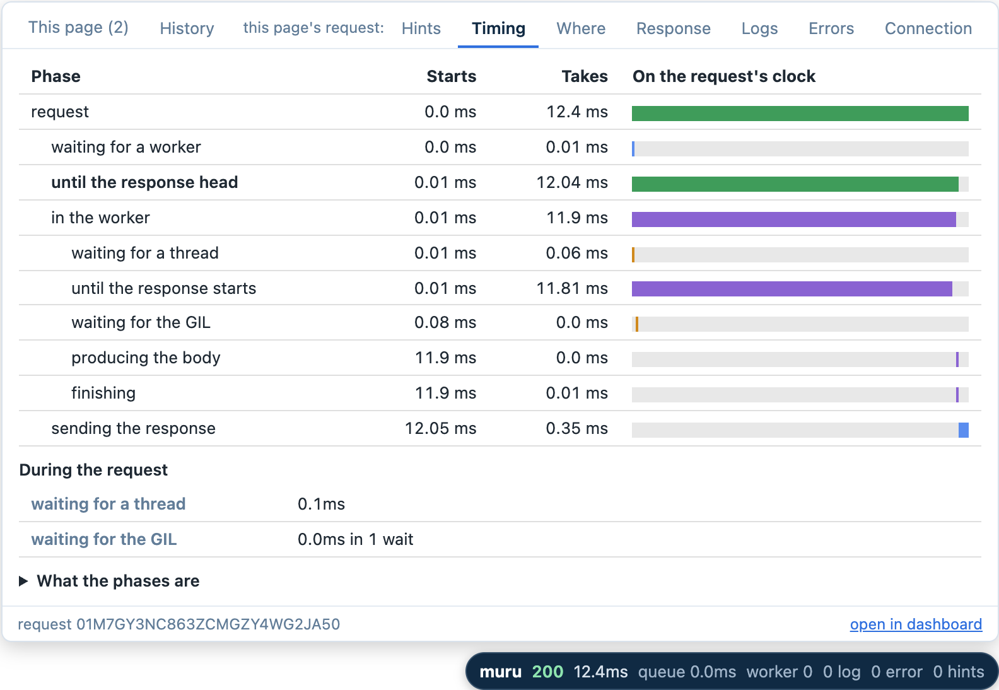
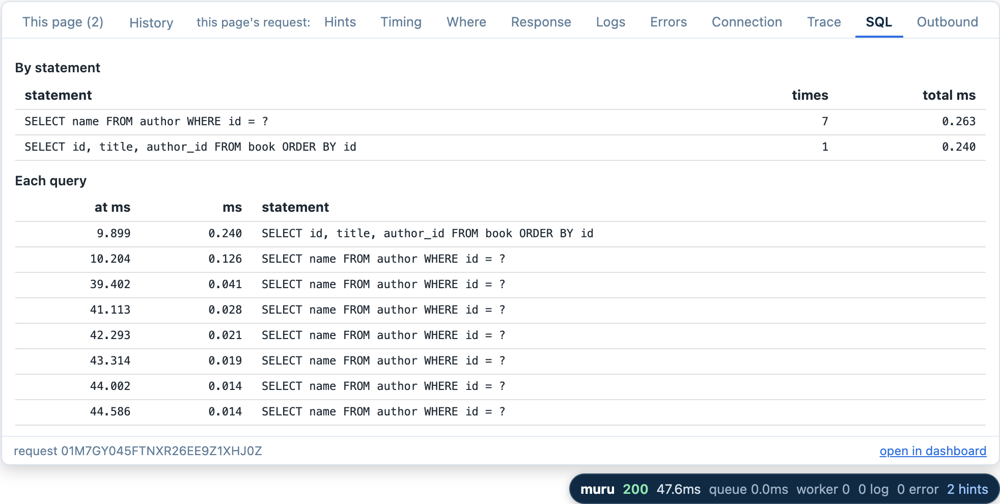
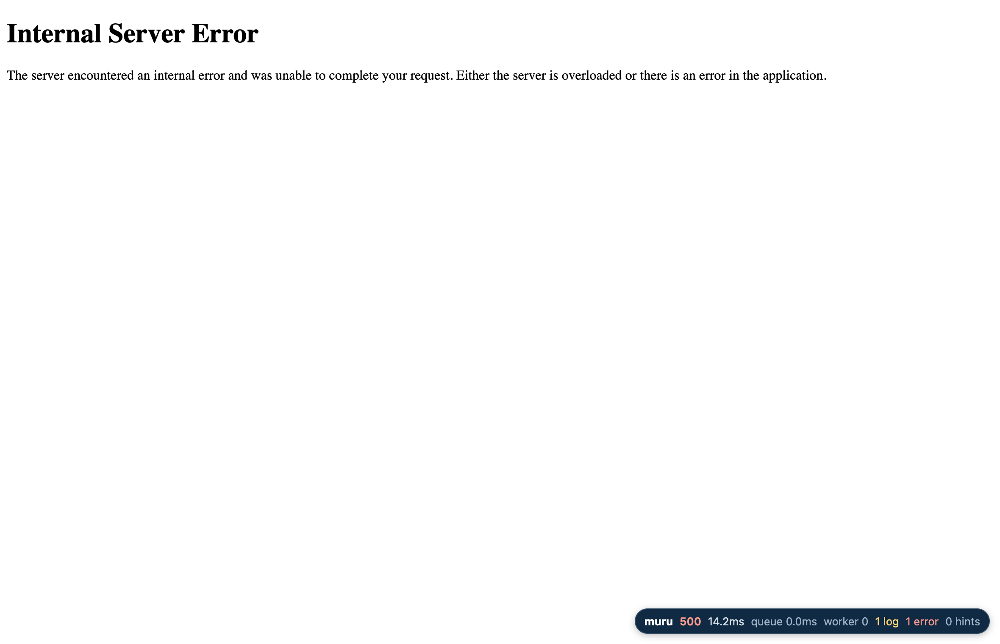
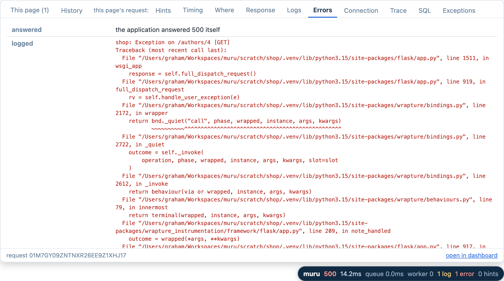
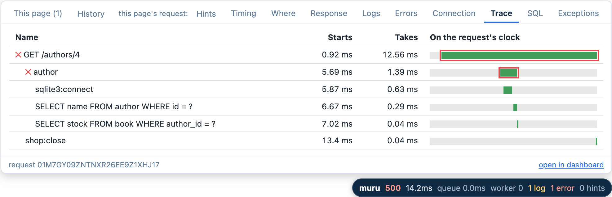
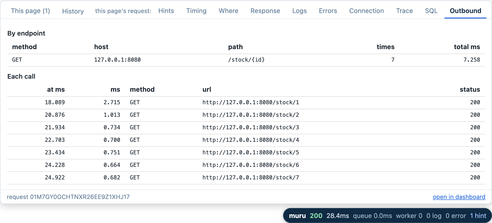
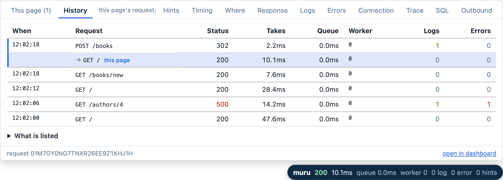
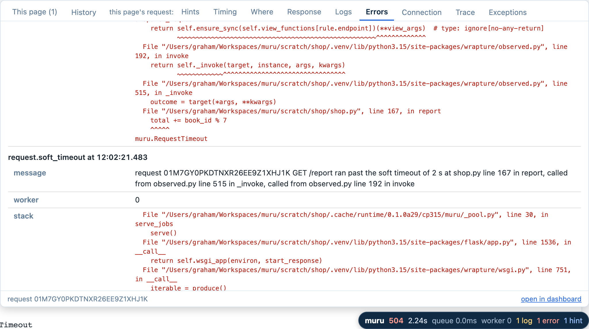
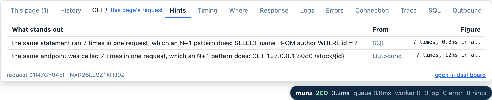

# Debugging a page

A development run keeps a record of every request it serves, and with
the toolbar on, every page shows its own record. With tracing on, the
record also has the request's calls, queries and calls to other
services. This tutorial uses all of that on a small shop with a fault
on nearly every page, each put there on purpose, and fixes them one at
a time.

In about twenty minutes you will:

- read a request's timings in the browser's developer tools;
- turn the toolbar on and read a page's record;
- turn tracing on and find an N+1 query, then fix it;
- find what failed on an error page;
- find a page that calls another service once per row;
- reach the POST behind a redirect;
- see where a request was when it ran too long;
- let Muru's hints point at all of it at once;
- read a record from the command line.

This tutorial assumes you have done [the first
tutorial](first-wsgi-app.md). Tracing uses
[wrapture](https://pypi.org/project/wrapture/), which needs Python 3.12
or later.

## A shop with faults

```
mkdir shop && cd shop
uv init --bare --python 3.12
uv add flask wrapture wrapture-instrumentation
```

Save this as `shop.py`:

```{literalinclude} code/shop/shop.py
:language: python
```

The shop lists its books with their authors and how many are in stock,
which it asks a stock service for. In a real shop that service would be
someone else's; here it is part of the same application, at `/stock/`,
so nothing else needs to be running. The first request makes the
database, `shop.db`, beside `shop.py`.

Tell Muru where the application is, and give requests a soft timeout of
two seconds, which a later step needs. Add this to `pyproject.toml`:

```toml
[tool.muru]
entrypoint = "shop:app"

[tool.muru.timeouts]
soft_timeout = "2s"
```

## The timings in the browser

```
muructl run
```

Open http://127.0.0.1:8080/ and the list of books appears. Open the
browser's developer tools, choose the Network tab and reload. Select
the page's own request and open its Timing section: under Server Timing,
Chrome and Firefox show `queue`, how long the request waited for a
worker, and `app`, how long the application took to produce the response
head. Every response of a development run says the same in its headers:

```
curl -s -D - -o /dev/null http://127.0.0.1:8080/
```

```
HTTP/1.1 200 OK
content-type: text/html; charset=utf-8
server: muru
x-request-id: 01M7GXRH5KEY3N303NCTTDJQS1
server-timing: queue;dur=0.01, app;dur=22.20, muru;desc="01M7GXRH5KEY3N303NCTTDJQS1"
muru-request-link: http://127.0.0.1:8081/request/01M7GXRH5KEY3N303NCTTDJQS1
transfer-encoding: chunked
```

`Muru-Request-Link` is the request's page on the run's dashboard, which
shows the whole record. The toolbar shows the same record on the page
itself.

## The toolbar

Stop the run with Ctrl-C, and turn the toolbar on in `pyproject.toml`:

```toml
[tool.muru.run]
toolbar = true
```

```
muructl run
```

Reload the list. A badge in the bottom right corner gives the request's
status, its total time, its time waiting for a worker, the worker that
served it, and how many log records, errors and hints it had. Click it
to open the record:



Each tab is a panel of the record: Timing, its phases, from waiting for
a worker to sending the response; Where, the worker and thread that
served it; Response, its status, headers and compression; and Logs,
what the application logged while serving it. Nearly all of the list's
time is in the application, until the response head.

## An N+1 query

Stop the run, and turn tracing on with wrapture's instrumentation for
Flask, sqlite3 and `urllib.request`, which records what the application
does inside the request:

```toml
[tool.muru]
entrypoint = "shop:app"
tracing = true

[[tool.wrapture.instrument]]
name = "flask"

[[tool.wrapture.instrument]]
name = "sqlite3"
statement = true

[[tool.wrapture.instrument]]
name = "urllib.request"
```

```
muructl run
```

Reload the list and open the toolbar. It has new tabs: **Trace**, the
request's view, queries and calls as a tree on its clock; **SQL**, its
queries; and **Outbound**, its calls to other services. Open SQL:



"By statement" groups the queries, so the same statement with different
values is one line: the books were fetched once, and then the author of
each book was fetched on its own, seven times for seven books. That is
the N+1 pattern, and on a real list of hundreds of books, it is hundreds
of queries. The fix is to fetch the authors with the books, in one
query. Change `books()` in `shop.py` to this:

```{literalinclude} code/shop/joined.py
:language: python
:pyobject: books
```

When you save the file the run reloads, and the terminal says so:

```
muru: reloading, /home/you/shop/shop.py changed
muru: switched to release r2
```

Reload the page. The SQL panel has one statement, run once.

## A failing page

Open http://127.0.0.1:8080/authors/4. Flask's own error page appears,
with the toolbar's badge on it, showing the 500 and one error:



Flask caught the exception, logged it, and answered 500 itself. The
Errors panel says so, with the traceback it logged:



The Trace panel shows which operations failed, marked ✕ with their bars
outlined in red: the view, `author`, that the exception escaped, and the
request, which Flask's error handling noted it against.



The Exceptions panel lists the same two: the one that escaped `author`,
and the one Flask handled for the request, marked "(handled)". The
traceback ends at the average: Anne Brontë has no books in the shop, so
there is nothing to divide by. Change `author()` to this:

```{literalinclude} code/shop/fixed.py
:language: python
:pyobject: author
```

and the page says she has no books yet.

## A page that calls another service

Go back to the list and open its Outbound panel:



The page asks the stock service about each book on its own:
`/stock/1`, `/stock/2` and so on, one call per row. "By endpoint" groups
them as one endpoint, `/stock/{id}`, called seven times; each call is
below it, with its URL and status. Each is quick here, on the same
machine, but over a network every call adds a round trip. The stock
service can also answer for several books at once, at `/stock?ids=`.
Change `books()` and `in_stock()` to use it:

```{literalinclude} code/shop/fixed.py
:language: python
:pyobject: books
```

```{literalinclude} code/shop/fixed.py
:language: python
:pyobject: in_stock
```

Reload the page: the Outbound panel has one call.

## A form that redirects

Open http://127.0.0.1:8080/books/new and click Add. The form posts to
`/books`, which adds the book and redirects back to the list, so the
toolbar you see is the list's. The POST that did the work is in the
**History** tab, the run's recent page loads and form submissions,
newest first, with each redirect joined to the request it led to:



Click the `POST /books` row. The toolbar shows that request's record:
its Logs panel has the warning it logged, and its SQL panel the
`INSERT`. "this page's request" goes back to the list.

## A request that runs too long

Open http://127.0.0.1:8080/report. Two seconds later, Muru's own page
for a timeout appears: the report ran past the soft timeout, and the
worker interrupted it. Open the toolbar's Errors panel and scroll past
the traceback:



Muru took the stack of the request's thread just before it interrupted
it, and the record keeps it with the event's message. It ends in
`report`, at the loop. The worker carried on serving; only the one
request was stopped. A request that holds its worker past the hard
timeout, where Python cannot interrupt it, has the same: the stacks of
the worker's threads, taken before the worker was replaced.

## Hints

Each fault so far was found by opening the right panel and knowing what
to look for. The **Hints** panel does that for you: it reads the
record, and lists what stands out, with the panel and the figure each
hint comes from. The badge counts them.

The records of the run's earlier requests are kept, so open History,
pick the oldest `GET /`, from before its fixes, and open its Hints:



It names both faults of the list: the statement run once per book, and
the stock endpoint called once per book. The list as it is now has no
hints. The [toolbar guide](../howto/toolbar.md#hints) lists every hint
and when it is shown.

## Without a browser

A JSON endpoint has no page for the toolbar, but its requests have
records too. Ask for the books:

```
curl -s -D - -o /dev/null http://127.0.0.1:8080/api/books | grep -i x-request-id
```

```
x-request-id: 01M7GXJ93PN0CFPKE5WVVX1WN8
```

and read its record from the command line, in the project's directory:

```
muructl debug request 01M7GXJ93PN0CFPKE5WVVX1WN8
```

```
GET /api/books HTTP/1.1  200  1.0ms  at 11:54:26.678
request 01M7GXJ93PN0CFPKE5WVVX1WN8

Hints
  What stands out
    none

Timing
  request                        1.0ms  from 0.0ms
    waiting for a worker         0.0ms  from 0.0ms
    until the response head      0.8ms  from 0.0ms
...
```

Every panel is there, as text. `--json` prints the whole record. A
coding agent reads the same through Muru's [MCP
server](../howto/coding-agents.md): its `debug` tool takes `what` set to
`request` and the request's ID.

## Clean up

Stop the run with Ctrl-C. The records go with it: they are kept in
memory only, for the last 1000 requests.

## From here

- [Inspecting requests in development](../howto/toolbar.md) covers
  every panel of the record, the page view, the history, the hints and
  what is kept.

- [Tracing](../howto/tracing.md) covers wrapture's configuration, the
  Trace, SQL, Outbound and Exceptions panels, and tracing on one
  machine only.

- [Adding panels](../howto/panels.md) covers panels of the application's
  own.

- [Timeouts](../howto/timeouts.md) covers the soft and hard timeouts, and
  the deadline a request has at the edge.
